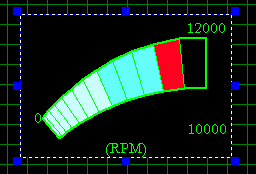
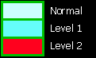
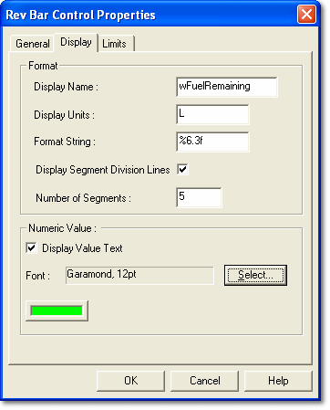
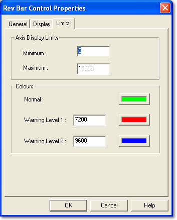

# Rev Bar Control

The Rev Bar Control provides a combined pictorial and numeric display of the instantaneous value of its associated Parameter. It is typically used to display engine RPM.

The Rev Bar is divided into a user-defined number of segments. The range between the axis display limits is divided equally, so each segment covers the same range of values.

As the value increases, segments are progressively lit to show the band in which the current value lies. If **Display Value Text** is selected, the value is also shown below the Rev Bar.

Warning levels show Normal, Warning Level 1 and Warning Level 2 in different colours as the value rises through the range.

## Rev Bar Control Properties

Control properties apply only to the selected Control. Properties that apply to the whole Dash Configuration are described in [PCU Dash Properties](../pcu-dash-properties/index.md). To open the Rev Bar Control Properties, right-click the Control and select **Properties...**.

There are three tabs:

- **General** - Common to all Parameter Controls; described in [Numeric Control](numeric-control.md#general-tab).
- [Display](#display-tab)
- [Limits](#limits-tab)

### Display tab

**Format**

- **Display Name** - The name shown beneath the Rev Bar. Defaults to the Parameter name.
- **Display Units** - The units shown after the Display Name. Defaults to the Parameter's units.
- **Format String** - The format of the Parameter value, for example 0.000.
- **Display Segment Division Lines** - When selected (the default), lines are drawn between the segments. When cleared, the lines are not drawn, but the Rev Bar is still divided into the number of segments set.
- **Number of Segments** - The number of segments, from 1 to 20. The default is 5 (3 Normal, 1 Warning Level 1 and 1 Warning Level 2).

**Numeric Value**

- **Display Value Text** - When selected (the default), the Parameter value is shown beneath the Rev Bar. Click the colour button to choose the colour of the value text.
- **Font** - The font used for the value text. Click **Select...** to choose the font style and size.

### Limits tab

**Axis Display Limits**

- **Minimum**, **Maximum** - The minimum and maximum values shown on the Rev Bar. Default to the Parameter's physical limits. **Maximum** must be greater than **Minimum**.

**Colours**

- **Normal** - Click the colour button to choose the colour for values below Warning Level 1. Default green.
- **Warning Level 1** - Enter a value and choose a colour. Values above this level and below Warning Level 2 are shown in this colour. Default red.
- **Warning Level 2** - Enter a value and choose a colour. Values above this level are shown in this colour. Default blue. Warning Level 2 cannot be less than Warning Level 1; set them equal to use only one warning level.

!!! note
    By default Warning Level 1 is set 60% and Warning Level 2 is set 80% of the way from the display minimum to the display maximum, matching the default of five segments.
