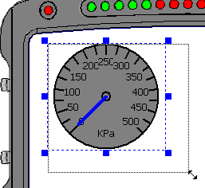
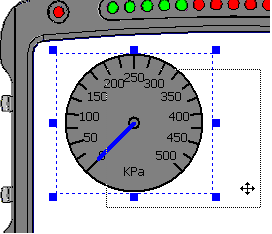

# Size and Move Display Controls

**To size a Control:**

1. Select the Control.
2. Hold the cursor over a grab handle.
3. Click and drag to size the Control.

**To move a Control:**

1. Select the Control.
2. Hold the cursor over any part of the Control.
3. Click and drag the Control to a new position.

To undo the last move or resize on the current page, select **Undo Last Move/Resize** from the Main Menu or context menu, or press Ctrl+Z.

To align a Control with the guide grid, right-click it and use the **Snap To Grid** commands. See [PCU Context Menus](../pcu-context-menus.md).
