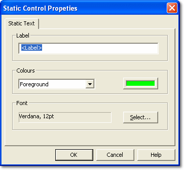

# Static Labels

Static Labels are text-only Controls. They are not associated with a Parameter.

To add a Static Label, right-click the display area and select **Add Static Label**. A label with the text `<Label>` is added where you clicked. To change it, right-click the label and select **Properties...** to open the Static Control Properties dialog box.

| Option | Description |
|---|---|
| **Label** | The text of the label. |
| **Colours** | Select **Foreground** or **Background** from the drop-down list, then click the colour button to choose a colour. The text is drawn in the foreground colour. |
| **Font** | Shows the font used for the label. Click **Select...** to choose the font style and size. |
| **Automatic Sizing** | When selected, the font is fitted to the label when you resize it, and the label is resized to fit its text when you change the text or font. Cleared by default. |

## Conditional Text

A Conditional Text Control shows a text message on the display when a Parameter condition is met, for example a warning to the driver. To add one, right-click the display area and select **Add Conditional Text**. Right-click the Control and select **Properties...** to open the Conditional Text Control Properties dialog box.

| Option | Description |
|---|---|
| **Colours** | Select **Foreground** or **Background**, then click the colour button to choose a colour. |
| **Font** | Shows the font used for the messages. Click **Select...** to choose the font style and size. |
| **Conditions** | Lists the conditions, with the columns **Parameter**, **Lo Threshold**, **Hi Threshold** and **Text**. Use **Add Condition ...**, **Edit Condition ...** and **Remove Condition** to manage the list. |
| **Display time for each message (secs)** | How long each message is shown. The default is 10 seconds. |
| **Switch to cancel displayed message** | Select **None** or one of the display unit switches. Pressing the selected switch cancels the message currently shown. A cancelled message is shown again if its condition clears and then becomes true again. |

**Add Condition ...** and **Edit Condition ...** open the PCU Condition dialog box:

- **Parameter** - Click **Select...** to choose the Parameter. A Parameter must be selected.
- **Lo Threshold**, **Hi Threshold** - The thresholds for the condition.
- **Condition occurs inside threshold values** - When selected, the condition is true when the value is between the thresholds. When cleared, it is true when the value is outside them.
- **Text to display if condition is true** - The message shown on the display.
