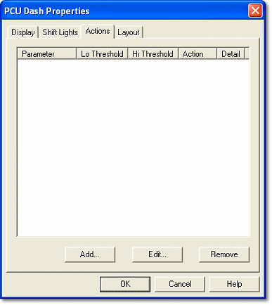
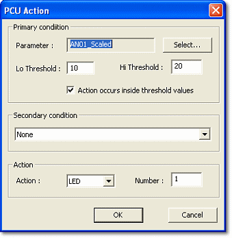

# Dash Properties - Actions

Use the Actions tab to add Actions to the Dash Configuration and to edit and remove existing Actions.

Actions are configured in the [PCU Action](#pcu-action-dialog-box) dialog box. They are used, for example, to alert the driver to specific conditions or to let the push buttons change page. To open the dialog box, click **Add...** to add a new Action, or select an existing Action and click **Edit...**.

## Actions list

The list summarises the Actions configured for the Dash Configuration:

| Column | Description |
|---|---|
| **Parameter** | The Parameter associated with the Action. |
| **Lo Threshold**, **Hi Threshold** | The thresholds for triggering the Action, set in the PCU Action dialog box. |
| **Action** | The Action selected, for example Flash All LEDs. |
| **Detail** | The number or percentage entered for the Action, for example the page number or dimming percentage. |

| Button | Description |
|---|---|
| **Add...** | Opens the PCU Action dialog box to add a new Action. |
| **Edit...** | Opens the PCU Action dialog box for the selected Action. |
| **Remove** | Removes the selected Action from the Dash Configuration. |

!!! note
    The display unit's push buttons can be assigned Actions which control the display, for example moving between pages. See [Assign Actions to push buttons](../../assign-actions-to-push-buttons.md).

## PCU Action dialog box

The PCU Action dialog box is used to configure new and existing Actions.

An Action is triggered when the value of its Parameter meets the Primary condition, that is, the Lo and Hi thresholds set in this dialog box. An optional Secondary condition can be added by selecting another Action already defined in the configuration; the Action is then only triggered when that Action's condition is also met.

### Primary condition

- **Parameter** - The Parameter associated with the Action. Click **Select...** to choose a Measurement Parameter. A Parameter must be selected.
- **Lo Threshold**, **Hi Threshold** - The threshold values for triggering the Action. The Hi Threshold cannot be less than the Lo Threshold.
- **Action occurs inside threshold values** - When selected, the Action is triggered when the Parameter value is between the Lo and Hi Thresholds. When cleared, the Action is triggered when the value is outside them.

### Secondary condition

Select **None**, or select one of the other Actions in the configuration. Each Action is listed by its Parameter name, "between" or "outside", and its Lo and Hi Thresholds.

### Action

- **Action** - Select an [Action](actions.md) from the drop-down list: Page, LED, Pg Up, Pg Down, Backlight Dim, Shiftlight Dim or Flash All LEDs.
- **Number** / **Percentage** - The label and meaning depend on the Action: the page number for **Page**, the LED number (0 or 1) for **LED**, or a percentage from 0 to 100 for **Backlight Dim** and **Shiftlight Dim**. The field is disabled for Pg Up, Pg Down and Flash All LEDs.
