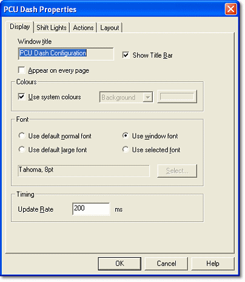

# Dash Properties - Display tab

Use the Display tab to set the window title, colours, default font and update rate of the Dash Configuration.

| Option | Description |
|---|---|
| **Window title** | The title shown in the window's title bar. The default is **PCU Dash Configuration**. |
| **Show Title Bar** | Shows the window's title bar. Not available while the window is maximised. |
| **Appear on every page** | Places the PCU Dash Configuration window on every page of the System Monitor Desktop. |

!!! note
    To restore the title bar if it is hidden, make sure no Control is selected, right-click the display area and select **Dash Properties...**. Select **Show Title Bar** and click **OK**.

## Colours

**Use system colours** - When selected, the window uses the default system colours. When cleared, the Background and Foreground colours can be set: select **Background** or **Foreground** from the drop-down list, then click the colour button to choose a colour. The colours apply to all pages in the configuration. The Foreground colour is also used for the guide grid and as the default colour of new Controls.

## Font

Selects the font applied to new Controls added to the display area:

- **Use default normal font**
- **Use default large font**
- **Use window font**
- **Use selected font** - Enables the **Select...** button, which opens the Font dialog box so you can choose a font and its attributes.

!!! note
    Fonts are scaled in proportion to the size of the Control as it is made larger or smaller in the display area.

## Timing

**Update Rate** - The interval, in milliseconds, at which the displayed Parameter values are updated. The default is 200 ms. The update rate is included in the configuration downloaded to the PCU-400.
