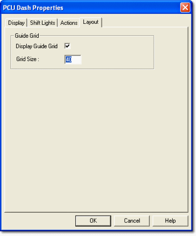

# Dash Properties - Layout

Use the Guide Grid options to configure the grid shown over the display area.

| Option | Description |
|---|---|
| **Display Guide Grid** | When selected, a grid is shown over the display area and the **Snap To Grid** commands on the Control [context menu](../pcu-context-menus.md) are enabled. Cleared by default. |
| **Grid Size** | The grid spacing, from 5 to 100. The default is 10. |

The grid is drawn in the Foreground colour. To change it:

1. Go to the [Display](display-tab.md) tab and clear **Use system colours**.
2. Select **Foreground** from the drop-down list.
3. Click the colour button and choose a colour.

The grid is not shown on the display unit.
