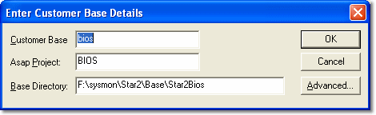

# Adding and Editing Customer Bases

The Enter Customer Base Details dialog box is opened when **Add** or **Edit** is clicked in the Customer Bases panel of the Select Active Multi-Application Base dialog box.

- **Add** - Opens the dialog box with no entries. Enter data and click **OK** to add a new entry to the list of Customer Bases.
- **Edit** - Opens the dialog box with the entries for the selected Customer Base. Edit the data and click **OK** to update the existing entry.

Enter data as follows:

| Field / button | Description |
|---|---|
| **Customer Base** | The Customer Base name. It must not be empty and must not contain a backslash (\\). |
| **Browse** | Selects an existing Program Version (.pgv) file and uses it to fill in the dialog box: the **Asap Project** is taken from the Program Version, the **Base Directory** is set to the parent of the Program Version folder, and the **Customer Base** name is set to the ASAP project name followed by an underscore and the drive letter. |
| **Asap Project** | A valid [ASAP](../asap-compatibility.md) project name must be entered. The project name is embedded in the ASAP file. System Monitor will only load ASAP files with a project name that matches the name entered here. |
| **Base Directory** | A full path, which should be a sub-directory of the Multi-Application Base Directory. Drives A: and B: cannot be used. If the directory does not exist, System Monitor asks whether to create it. |
| **OK** | Adds or updates the Customer Base in the Select Active Multi-Application Base dialog box. |
| **Advanced** | Opens the [Advanced Customer Base Settings](customer-base-advanced-settings.md) dialog box, which controls how the Customer Base is used. |

!!! note
    Each Customer Base must have a unique name. If you add a Customer Base with the same name as an existing one, you are asked whether to overwrite the existing one. If you remove or overwrite a Customer Base that is contained in a Multi-Application Base, the Project will not be able to access data in that Customer Base.

**See also:** [Customer Base](index.md); [Customer Base Advanced Settings](customer-base-advanced-settings.md); [Multi-Application Base](multi-application-base.md)
