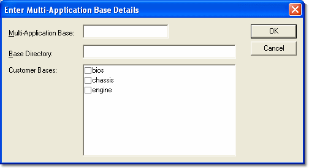

# Adding and Editing Multi-Application Bases

The Enter Multi-Application Base Details dialog box is opened when **Add** or **Edit** is clicked in the Multi-Application Bases panel of the Select Active Multi-Application Base dialog box.

- **Add** - Opens the dialog box with no entries. Enter data and click **OK** to add a new entry to the list of Multi-Application Bases. You can only add a Multi-Application Base if you are a [Free User](free-user.md).
- **Edit** - Opens the dialog box with the entries for the selected Multi-Application Base. Edit the data and click **OK** to update the existing entry.

Before a Multi-Application Base is added, one or more Customer Bases must be created to include in it. The Customer Base Directories should be sub-directories of the Multi-Application Base Directory.



Enter data as follows:

| Field | Description |
|---|---|
| **Multi-Application Base** | The Multi-Application Base name. It must not contain a backslash (\\). |
| **Base Directory** | Any directory to which you have access (drives A: and B: cannot be used). If the directory does not exist, System Monitor asks whether to create it. |
| **Customer Bases** | Select the checkboxes next to the [Customer Base](index.md) names to assign them to the Multi-Application Base. |
| **Prime Param Override file** | Optional. Enter or **Browse** for a Prime Parameter Override (.ppo) file. See below. |

!!! note
    The Base Directories of the selected Customer Bases should be below the Multi-Application Base Directory.

## Prime Parameter Override file

The Prime Parameter Override file is an optional file used to configure (add, remove or amend) prime parameters within a logging configuration when used with the ATLAS live data feed functionality.

The file is a comma separated value file with the extension .ppo. It has three columns: App id, parameter identifier and minimum frequency. For example:

```
1,vCar,200
1,tTotalShiftTime,500
```

!!! note
    The file does not have a header line.

If the path to a .ppo file is provided, it is used to override the prime parameters within the logging configuration. The .ppo file is parsed when the logging configuration is integrity checked, and the configuration is updated with the prime parameters as specified:

- New prime parameters can be added by including them in the file.
- Existing prime parameters can be adjusted by specifying a different minimum logging rate.
- Existing prime parameters can be removed by setting the minimum rate to zero (this removes the prime property from the parameter).

This functionality also requires the Advanced Setting **Enforce Prime Parameter requirements (Y/N)** to be enabled.

**See also:** [Multi-Application Base](multi-application-base.md); [Customer Base](index.md); [Free User](free-user.md)
