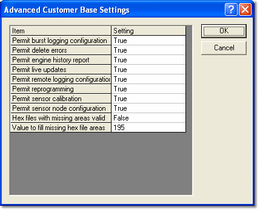

# Customer Base Advanced Settings

Advanced Customer Base settings are accessed by clicking **Advanced** in the Enter Customer Base Details dialog box. The settings control how the Customer Base is used. They apply only to the Customer Base that is being added or edited in the Enter Customer Base Details dialog box.

The Advanced Customer Base Settings dialog box shows a grid with an **Item** column and a **Setting** column. Select TRUE or FALSE for each item from the drop-down list. Numbers can be overwritten.

| Item | Default | Description |
|---|---|---|
| **Permit burst logging configuration** | TRUE | See [Burst Logging](../../data-acquisition/logging/burst-logging/index.md). |
| **Permit delete errors** | TRUE | See [Deleting Errors](../../data-display/other-displays/errors/deleting-errors.md). |
| **Permit engine history report** | TRUE | See [History Report](../../history-report/index.md). |
| **Permit live updates** | TRUE | See [Live Tune](../../tuning/live-tune.md). |
| **Permit remote logging configuration** | TRUE | See [Remote Logging](../../data-acquisition/logging/remote-logging/index.md). |
| **Permit reprogramming** | TRUE | See [Reprogramming the ECU](../../ecu-control/ecu-memory/reprogramming-the-ecu.md). |
| **Permit sensor calibration** | TRUE | See [Sensors & Actuators Tool](../../data-acquisition/sensors/sensors-and-actuators/index.md). |
| **Permit sensor node configuration** | TRUE | See [External Inputs Configuration](../../data-acquisition/sensors/external-inputs/external-inputs-configuration.md). |
| **Hex files with missing areas valid** | FALSE | If TRUE, [Hex files](../program-and-data-versions/index.md) are valid if they are missing one or more memory areas that are defined in the ASAP file. If FALSE, an error is reported when a Hex file has missing memory areas. This is recommended for TAGtronic systems. |
| **Value to fill missing hex file areas** | 195 | The byte value (decimal) that System Monitor uses to fill missing areas when loading the [Hex file](../program-and-data-versions/index.md). Should be set to 0xC3 (decimal 195) for Bosch control units. This prevents the unit from running if a missing memory area is accidentally downloaded. Missing memory areas are not normally used by editable parameters or specified in the programming sequence. |

**See also:** [Adding and Editing Customer Bases](adding-and-editing-customer-bases.md); [Customer Base](index.md)
