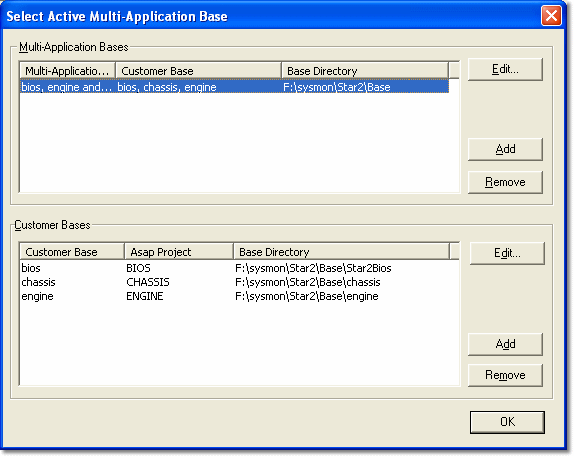

# Multi-Application Base

System Monitor uses Customer Bases to control access to files to prevent an ECU from being loaded with the wrong program (see [Project Management](../index.md)). The Customer Bases are associated with a Project by means of the Multi-Application Base for that Project.

Multi-Application Bases are usually set up by the control system supplier, in which case the base is selected automatically and a Project can be opened or created.

A Custom Installation may be required to configure your computer to recognise Multi-Application and Customer Bases.

**Select a Multi-Application Base:**

If more than one Multi-Application Base is available, select the one you want to work with as follows:

1. Select **File** > **Select Base** (Ctrl+S) to open the Select Active Multi-Application Base dialog box. This command is only available when no Project is open. When a Project is open, use **File** > **Close Project & Select Base**.
2. Select the row of the Multi-Application Base you want to use, then click **OK**.

!!! tip
    To find out which Multi-Application Base is in use when a Project is open, look at either the Import or the Export dialog box.

## Multi-Application Bases panel

This panel lists all the available Multi-Application Bases.

| Column | Description |
|---|---|
| **Multi-Application Base** | The name of the Multi-Application Base. |
| **Customer Base** | The Customer Bases contained within the Multi-Application Base. The names correspond to the names of the Customer Bases in the Customer Bases panel. |
| **Base Directory** | The location of the file directories for each Multi-Application Base. |

Each Multi-Application Base can also specify a Prime Parameter Override file. See [Adding and Editing Multi-Application Bases](adding-and-editing-multi-application-bases.md).

The following controls are available:

- **Edit** - Opens the Enter Multi-Application Base Details dialog box to allow the selected Multi-Application Base to be edited.
- **Add** - Opens the Enter Multi-Application Base Details dialog box to allow a new Multi-Application Base to be added. Only available if you are a [Free User](free-user.md).
- **Remove** - Deletes the selected Multi-Application Base. Only available if you are a Free User. The Free User Multi-Application Base cannot be removed.

!!! note
    Before adding a Multi-Application Base, make sure that you have one or more Customer Bases to include in it. The Customer Base Directories should be sub-directories of the Multi-Application Base Directory.

## Customer Bases panel

This panel lists all the available Customer Bases.

| Column | Description |
|---|---|
| **Customer Base** | The name of the Customer Base. |
| **Asap Project** | The name of the ASAP project embedded in the Program Version (see [Project Management](../index.md)). |
| **Base Directory** | The location of the file directories for each Customer Base. |

The following controls are available:

- **Edit** - Opens the Enter Customer Base Details dialog box to allow the selected Customer Base to be edited.
- **Add** - Opens the Enter Customer Base Details dialog box to allow a new Customer Base to be added.
- **Remove** - Deletes the selected Customer Base, after confirmation.

!!! note
    Each Customer Base must have a unique name. If you add a Customer Base with the same name as an existing one, you are asked whether to overwrite the original Customer Base definition.

!!! warning
    If you remove or overwrite a Customer Base that is contained in a Multi-Application Base, the Project will not be able to access data in that Customer Base.

**See also:** [Customer Base](index.md); [Adding and Editing Multi-Application Bases](adding-and-editing-multi-application-bases.md); [Adding and Editing Customer Bases](adding-and-editing-customer-bases.md); [Free User](free-user.md); [Project Management](../index.md); [Getting Started](../../getting-started/index.md); [Import](../files/importing-files.md); [Export](../files/exporting-files.md)
