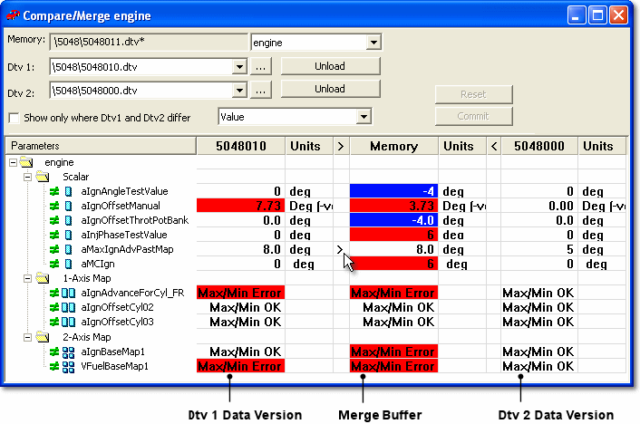

# Compare/Merge Tool

The Compare/Merge Tool compares parameters from one or two Candidate Data Versions with the Merge Buffer. It allows values from a Candidate Data Version to be merged into the Merge Buffer and then committed to the [Edit Buffer](../developing-data-versions/index.md).

!!! note
    When opened, the Compare/Merge Tool keeps a copy of the Edit Buffer called the Merge Buffer. The Merge Buffer values are displayed in the Memory column, between the Dtv 1 and Dtv 2 values.

To open the Compare/Merge Tool, select **DataWizard** > **Compare / Merge Tool**.

The top of the tool has the following rows:

- **Memory** - The Merge Buffer, with a drop-down list for selecting the application to compare.
- **Dtv 1** and **Dtv 2** - The two Candidate Data Versions, each with a browse button (**...**) and an **Unload** button.
- **Unlock List** - Shown for each row: the unlock list of that Data Version.

**Merge values:**

1. In the drop-down list on the **Memory** row, select the application that you want to compare.
2. On the **Dtv 1** row, browse for a Data Version or select one from the drop-down list of recently compared versions.

    !!! note
        The Dtv 1 and Dtv 2 Data Versions must share the same Program Version.

3. On the **Dtv 2** row, browse for or select a Data Version.
4. Select how parameter values are displayed from the drop-down list: **Value**, **Delta Value from Memory**, **Delta % from Memory**, **Delta Value from Dtv1**, **Delta % from Dtv1**, **Delta Value from Dtv2**, **Delta % from Dtv2**, **RAW Value** or **Value Unformatted**.

    The main window displays the differences between the Data Versions selected in Dtv 1 and Dtv 2 and the Merge Buffer.

5. To update a parameter value in the Merge Buffer with a value from one of the other Data Versions, click the **>** or **<** column in the appropriate cell. To undo the change, click the same cell again.

!!! note
    Merge Buffer values can be edited directly in the Memory column. If the Merge Buffer is different from the Edit Buffer, an asterisk is displayed in the **Memory** column header.

**Commit changed values:**

1. To commit all the changes in the Merge Buffer to the Edit Buffer, click **Commit**.

The display is updated to show only those parameters that are still different.

**See also:** [Compare/Merge Tool Features](compare-merge-tool-features.md); [Map Compare Window](map-compare-window.md)
