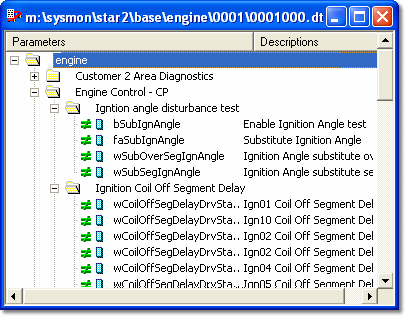

# Data Wizard - Candidate Version

The Candidate Data Version is a previously created Data Version that you want to compare with the contents of the Edit Buffer.

**Open a Candidate Data Version window:**

Select a Data Version to compare with the current one in one of these ways:

- Select **DataWizard** > **Open Data Version** and select a file.
- Select a Data Version file from the **Recent Files** list on the **DataWizard** menu.
- Select **File** > **Open** and select the Data Version file, but do not open it: click **DataWizard** instead.
- To open a Data Version from outside the active Customer Base, select **DataWizard** > **Open Any Data Version**.

The Candidate Data Version window appears on all pages. The full path name of the Data Version file is displayed in the title bar.

## Parameters

What the Candidate Data Version window displays depends on which parameters are selected and on the settings of the Parameter Mask. Only folders that contain parameters are shown. Open the folders to view the parameters.

By default, the parameters are shown in Groups. Use the context menu to display the parameters in a flat list if required.

Parameters are preceded by two symbols:

- **First symbol** - Shows the difference between the candidate parameter and the current parameter.
- **Second symbol** - Shows the type of parameter.

See [Parameter Masking](data-wizard-parameter-masking.md) and [Parameter Symbols](../../using-system-monitor/parameters/parameter-symbols.md) for a list of symbols and their meaning.

## Features

- Individual Candidate Data Version windows can be printed, but are not included if you print a Page.
- Candidate Data Version windows are not stored as part of the Desktop and are not reloaded if a Project is closed and re-opened.
- More than one Candidate Data Version window may be open at once. Merge operations apply to all the open Candidate Data Version windows.
- The display of Names and Descriptions follows the setting in the Parameter Explorer.

**See also:** [Printing Data Wizard Windows](../../using-system-monitor/printing/printing-data-wizard-windows.md); [Data Wizard](index.md)
