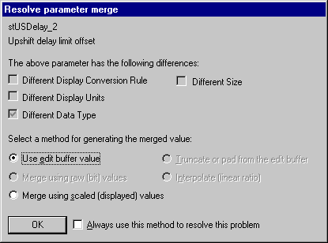
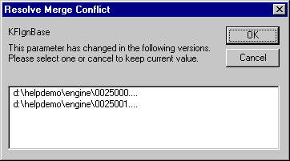

# Data Wizard - Merge

Merging overwrites parameters in the Edit Buffer with the same parameters in a Candidate Data Version. If a parameter has a Different Definition, it is not merged (see [Data Wizard - Parameter Masking](data-wizard-parameter-masking.md)).

**Merge parameters:**

Select **DataWizard** > **Merge** or **Merge All**:

- **Merge** - Merges the selected parameters into the Edit Buffer from the Candidate Data Version(s). The selected parameters and the Parameter Mask are not changed. Only the parameters displayed in the open Candidate Data Version window(s) are merged.
- **Merge All** - Merges all compatible parameters into the Edit Buffer. Before the merge, the selected parameters and the Parameter Mask are reset to their default values. All parameters are merged whether or not they are displayed in the open Candidate Data Version window(s).

The value that is merged depends on the difference:

- If the difference between the parameters is their value, conversion or units, the raw bit value (the value before conversion) is used.
- If the difference is their data type, the scaled value (the value after conversion) is used.

## Resolve Parameter Merge

If the differences cannot be resolved automatically, the **Resolve parameter merge** dialog box opens.

Check marks show which differences have been found for the parameter named at the top of the dialog box: **Different Display Conversion Rule**, **Different Display Units**, **Different Data Type** and **Different Size**.

Select a method for generating the merged value:

- **Use edit buffer value**
- **Merge using raw (bit) values**
- **Merge using scaled (displayed) values**
- **Truncate or pad from the edit buffer**
- **Interpolate (linear ratio)**

Select **Always use this method to resolve this problem** to apply the same method to later parameters with the same problem. Click **OK**, or **Cancel** to leave the parameter unchanged.

## Resolve Merge Conflict

If more than one Candidate Data Version is open and the same parameter has changed in more than one of them, the **Resolve Merge Conflict** dialog box opens.

1. The list shows the Candidate Data Version files that contain the parameter named at the top of the dialog box.
2. Select the file from which you want to merge the parameter and click **OK**.
3. If you click **Cancel**, the parameter is not merged and keeps its current value.

When the merge is complete, the updated current Data Version is compared with the Candidate Data Version(s).

If the merge was successful (and the Equal mask is not active), no parameters are displayed in the Candidate Data Version window(s). Parameters that failed to merge are displayed.

**See also:** [Conversion](../../using-system-monitor/parameters/parameter-properties/conversions/conversion-properties.md); [Data Wizard](index.md); [Data Wizard - Compare](data-wizard-compare.md)
