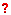
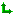
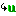
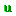
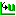
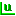
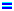
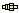

# Data Wizard - Parameter Masking

Parameter Masking allows parameters to be filtered for display.

The Parameter Masking commands are available in:

- the [Standard Tool Bar](../../using-system-monitor/tool-and-information-bars/standard-tool-bar.md)
- the [Data Wizard Menu](../../using-system-monitor/menus/data-wizard-menu.md): **Equal**, **Different Value**, **Different Units**, **Different Conversion**, **Different Data Type**, **Different Size**, **Different Definition**, **Different Sensor Calibration**, **Absent**, **Absent from Edit Buffer** and **Locked**
- the [Data Wizard - Window Menu](data-wizard-window-menu.md)

A mask filter is active when its menu item is checked and its toolbar button is down.

- **Candidate Data Version window** - All masks are available. All except **Equal** and **Different Sensor Calibration** are active by default.
- **Report View window** - The **Equal**, **Different Value** and **Different Sensor Calibration** masks are available. Only **Different Value** is active by default.

Masking symbols are displayed beside the parameter. The following list is in order of priority: if a parameter has more than one difference, the symbol highest in the list is shown. Parameters in the Candidate Data Version are compared with the same parameters in the current Data Version.

| Mask | Symbol | Description |
|---|---|---|
| **Absent** |  | The parameter is not present in the Candidate Data Version. |
| **Absent from Edit Buffer** |  | The parameter is present in the Candidate Data Version but not in the Edit Buffer. |
| **Different Definition** |  | The parameter in the Candidate Data Version has a definition that is different enough to prevent it being merged. For example, the definition has changed from array to scalar. Includes maps that have a different axis identifier. |
| **Different Size** |  | The parameter in the Candidate Data Version has a different size. For maps, the parameter has a different number of axis breakpoints. For strings or arrays, the parameter has a different size. |
| **Different Data Type** |  | The parameter in the Candidate Data Version has a different data type. For example, the data type has changed from float to double word. |
| **Different Conversion** |  | The parameter in the Candidate Data Version has a different conversion rule. See [Conversion Properties](../../using-system-monitor/parameters/parameter-properties/conversions/conversion-properties.md). |
| **Different Units** |  | The parameter in the Candidate Data Version has different Units text. See [Parameter Properties - Conversion Tab](../../using-system-monitor/parameters/parameter-properties/conversion-tab.md). |
| **Different Value** |  | In the Candidate Data Version window: the parameter and/or one or more axes in the Candidate Data Version have a different value from the same parameter or axis in the current Data Version. In the Report View window: the parameter and/or one or more axes in the [Edit Buffer](../developing-data-versions/index.md) have a different value from the same parameter or axis in the current Data Version. |
| **Axis Different Data Type** |  | One or more axes in the Candidate Data Version have a different data type. Masked by the Different Data Type filter. |
| **Axis Different Conversion** |  | One or more axes in the Candidate Data Version have a different conversion rule. Masked by the Different Conversion filter. |
| **Axis Different Units** |  | One or more axes in the Candidate Data Version have different Units text. Masked by the Different Units filter. |
| **Equal** |  | The parameter and all its axes in the Candidate Data Version have the same definition and value as in the current Data Version. |
| **Different Sensor Calibration** |  | Shows parameters which have different sensor calibration data. |
| **Locked** | | Shows parameters which are locked. |

**See also:** [Data Wizard](index.md); [Data Wizard - Candidate Version](data-wizard-candidate-version.md); [Data Wizard - Report View](data-wizard-report-view.md)
