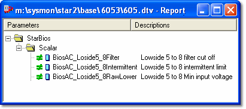

# Data Wizard - Report View

The Report View window shows the parameters in the Edit Buffer. These are compared with the same parameters in the current Data Version using the Different Value mask, so the window shows all changes made to the application since the Data Version was opened or last saved.

**Open a Report View window:**

- Select **DataWizard** > **Report View**. A window is opened for each Active Application.
- Or select an Application in the Parameter Explorer, open the context menu and select **Report View**.

The Report View window appears on all pages. The full path name of the Data Version file is displayed in the title bar. To avoid confusion, it is advisable to use Data Wizard on a blank Page.

!!! note
    Report View windows are not updated automatically. If you change any parameters in the Edit Buffer and want to force an update, select **DataWizard** > [Compare](data-wizard-compare.md) or **Compare All**.

## Parameters

What the Report View window displays depends on which parameters are selected and on the settings of the Parameter Mask. Only folders that contain parameters are shown. Open the folders to view the parameters.

By default, the parameters are shown in Groups. Use the context menu to display the parameters in a flat list if required.

Parameters are preceded by two symbols:

- **First symbol** - Shows the difference between the parameter in the Edit Buffer and the current Data Version.
- **Second symbol** - Shows the type of parameter.

See [Parameter Masking](data-wizard-parameter-masking.md) and [Parameter Symbols](../../using-system-monitor/parameters/parameter-symbols.md) for a list of symbols and their meaning.

## Features

- Report View windows are not stored as part of the Desktop and are not reloaded if a Project is closed and re-opened.
- Individual Report View windows can be printed, but are not included if you print a Page.
- The display of Names and Descriptions follows the setting in the Parameter Explorer.

**See also:** [Printing Data Wizard Windows](../../using-system-monitor/printing/printing-data-wizard-windows.md); [Data Wizard](index.md)
