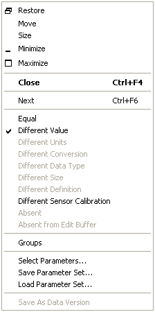

# Data Wizard - Window Menu

The Data Wizard Window Menu commands control the appearance of a Report View or Candidate Data Version window.

To open the Window Menu, click the icon at the left of the title bar of a Report View or Candidate Data Version window.

The Window Menu contains the standard window functions plus options specific to Report View and Candidate Data Version windows.

The following options are available for both window types:

| Option | Description |
|---|---|
| **Equal** | Sets the Parameter Mask to Equal. |
| **Different Value** | Sets the Parameter Mask to Different Value. |
| **Different Sensor Calibration** | Sets the Parameter Mask to Different Sensor Calibration. |
| **Groups** | Displays the parameters in Groups. |
| **Select Parameters** | Opens the Select Parameters dialog box. |
| **Save Parameter Set** / **Load Parameter Set** | Saves or loads the list of selected parameters. |

The following options are only available in Candidate Data Version windows:

| Option | Description |
|---|---|
| **Different Units** | Sets the Parameter Mask to Different Units. |
| **Different Conversion** | Sets the Parameter Mask to Different Conversion. |
| **Different Data Type** | Sets the Parameter Mask to Different Data Type. |
| **Different Size** | Sets the Parameter Mask to Different Size. |
| **Different Definition** | Sets the Parameter Mask to Different Definition. |
| **Absent** | Sets the Parameter Mask to Absent. |
| **Absent from Edit Buffer** | Sets the Parameter Mask to Absent from Edit Buffer. |
| **Locked** | Sets the Parameter Mask to Locked. |

**Save As Data Version** is only available in the window opened with **DataWizard** > **Compare with ECU**. It saves the uploaded data to a new Data Version.

**See also:** [Data Wizard](index.md); [Data Wizard - Parameter Masking](data-wizard-parameter-masking.md); [Window System Menu](../../using-system-monitor/menus/window-system-menu.md)
