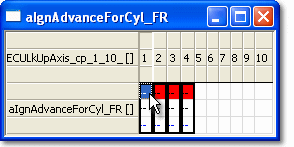
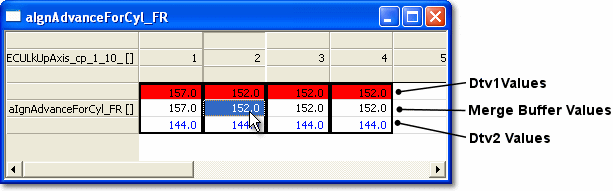

# Map Compare Window

The Map Compare Window displays values for Dtv 1, the current Data Version and Dtv 2. The window mimics the Map Window for the parameter, displaying the relevant number of breakpoints on all axes.

To open a Map Compare Window, double-click a 1-Axis or 2-Axis parameter in the Compare/Merge Tool window. A Map Compare Window for a 1-Axis parameter is shown below.

## Compare Overview mode

When opened, the Map Compare Window highlights the cell or block of cells where there are differences between the current Data Version and Dtv 1 or Dtv 2. In Overview mode, no values are shown.

## Compare Grid mode

Double-click in the highlighted block to expand the cell or block of cells and view the values. Values for the current Data Version are displayed between the values for the Dtv 1 and Dtv 2 Data Versions.

To return to Overview mode, select **Compare Overview** from the window's context menu. **Compare Grid** switches to Grid mode.

!!! note
    The values for the current Data Version can be edited in the usual way, using the Edit Bar or Maths Bar or by editing the cell directly. The Dtv 1 and Dtv 2 values cannot be changed.

**See also:** [Map Compare Window Features](map-compare-window-features.md)
