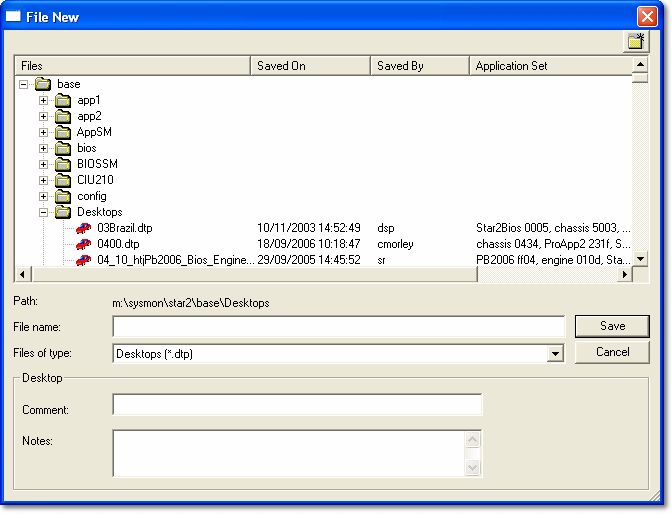

# Creating New Files

To create a new file, select **File** > **New** (Ctrl+N) to open the [File Type Selection](file-type-selection.md) dialog box.

If no Project is open, the following selections are available:

- [Program Version](../program-and-data-versions/creating-a-program-version.md) - Program and Base Data Version files are generated by System Monitor when a new Program Version is created.
- [Project](../projects/creating-a-project/stage-1-define-project.md) - Configures a System Monitor project. Consists of an expected hardware set-up, Program Versions, Data Versions, a Desktop and Logging Configurations.

If a Project is open, the following selections are available. Some types are only listed if the ECU supports them.

- [Program Version](../program-and-data-versions/creating-a-program-version.md) - Creating a Program Version closes the current project.
- [Desktop](../../using-system-monitor/desktop/desktop-files.md) - Desktops are stored as .dtp files in the \Desktops\ sub-directory. A Desktop is created when a Project is created.
- [Live Logging Config](../../data-acquisition/logging/live-logging/index.md) - How System Monitor obtains data from a connected ECU.
- [Sensor Set](../../data-acquisition/sensors/sensors-and-actuators/sensor-sets.md) - Sensor and Actuator data, stored in the \SenSets\ sub-directory.
- [Burst Logging Config](../../data-acquisition/logging/burst-logging/index.md) - How an ECU stores data in Burst Memory while not connected to System Monitor.
- [Remote Logging Config](../../data-acquisition/logging/remote-logging/index.md) - How an ECU stores data in DATALab memory while not connected to System Monitor.
- [External Inputs Config](../../data-acquisition/sensors/external-inputs/external-inputs-configuration.md) - Configures sensor inputs and applies calibration data to sensors connected to the ECU.
- **Pot Board Config** - The Pot Board (adjustment board) configuration, stored in the \PotBoard\ sub-directory.
- [History Report](../../history-report/history-report-files.md) - Statistics about the operation of a vehicle, extracted from the ECU.
- [Virtual Parameters](../../using-system-monitor/parameters/virtual-parameters/virtual-parameter-files.md) - Virtual Parameters created for a Project, stored in the \Virtuals\ sub-directory.
- [CAN Config](../../data-acquisition/logging/can-configuration/can-configuration-dialog-box/index.md) - Configures Transmit CAN messages for logging by an external unit, and Receive CAN messages for logging internally, using the CAN buffers.
- [Project](../projects/creating-a-project/stage-1-define-project.md)

When you select the file type, the currently open file of that type is closed and either a new file is created or the File New dialog box opens:

The example above is for a **Desktop** file.

Enter or browse for a path and file name for your new file within the Multi-Application Base Directory. It is recommended that you place the file in the appropriate directory (see [Project Files](types-of-files/project-files.md)), but this is not essential. Add or amend the Comment and Notes as required.

**See also:** [Files](index.md); [Multi-Application Base](../customer-bases/multi-application-base.md); [Opening Files](opening-files.md); [Project Files](types-of-files/project-files.md); [Saving Files](saving-files.md)
