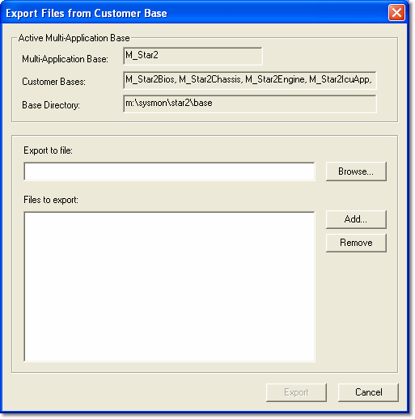

# Exporting Files

To copy Project files from one Multi-Application Base to another, the files must first be exported.

Select **File** > **Export** to open the **Export Files from Customer Base** dialog box.

The **Active Multi-Application Base** panel displays read-only information about the Multi-Application Base that is currently in use: the Multi-Application Base, its Customer Bases and its Base Directory.

**Export files:**

1. In **Export to file**, enter or browse for the path and name of the export file.

    The export file has the extension .smx and can only be read by the [Import](importing-files.md) command in System Monitor. The files shown in the **Files to export** list are included in the export file.

2. Click **Add** to add a file to the list. The File Open dialog box opens so that you can select files from your [Multi-Application Base](../customer-bases/multi-application-base.md) directory. If you select a Project (.prj) file, all the files associated with the project are included in the export.
3. To remove a file from the list, select the file and click **Remove**. **Select All** and **Deselect All** select or clear all the files in the list.
4. Click **Export** to create the export file and close the dialog box.

## Export Project

**File** > **Export Project** (Ctrl+T) quickly creates a snapshot of the Project. It creates an export file containing all the files in the Project. The file is given the same name as the project, with the extension .smx, and is placed in the same directory as the project.

The Export Files from Customer Base dialog box is not opened, and there are no options with this command.

**See also:** [Importing Files](importing-files.md); [Multi-Application Base](../customer-bases/multi-application-base.md)
