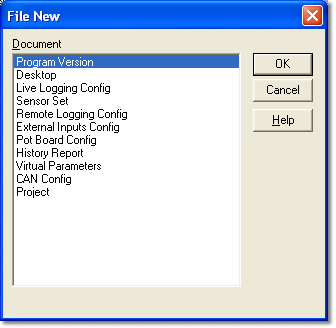

# File Type Selection

The File Type Selection dialog box appears when you use the **New**, **Open**, **Save** or **Save As** commands on the **File** menu.

The **Document** list shows the types of file that are available for that command. Select the type of file you require and click **OK**.

**See also:** [Creating New Files](creating-new-files.md); [Opening Files](opening-files.md); [Saving Files](saving-files.md)
