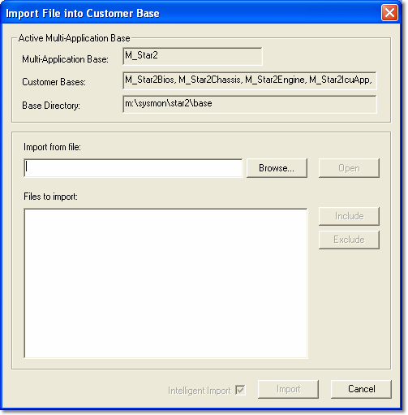

# Importing Files

To copy Program and Data Version files from one Multi-Application Base to another, the files must first be [exported](exporting-files.md). The export (.smx) files can be read by the Import command.

Select **File** > **Import** (Ctrl+I) to open the **Import File into Customer Base** dialog box.

The **Active Multi-Application Base** panel shows the Multi-Application Base, its Customer Bases and its Base Directory. The **Multi-Application Base** drop-down list lets you select the Multi-Application Base to import into. (When [Unit.Def](../unit-def-management/project-import.md) configuration is enabled, it selects the working folder instead.)

**Import files:**

1. In **Import from file**, enter or browse for the path and name of the .smx file.
2. The files included in the export file are shown in the **Files to import** list. Select the check boxes of the files you want to import. Alternatively, highlight the files and click **Include**; to deselect, click **Exclude**. **Select All** and **Deselect All** select or clear all the files.
3. Set the import options:
    - **Intelligent Import** (selected by default) - Imports the files into the directory structure of the active Multi-Application Base.
    - **Skip duplicate files** (selected by default) - Skips a file if it already exists.
4. Click **Import** to extract the files into the current Base directory and close the dialog box, or click **Import and Open** to import the files and then open them.

If a file already exists and is not skipped, you are asked whether to overwrite it (**Yes**, **Yes to All**, **No** or **No to All**). If the path for an imported file does not exist, the Select Import Path dialog box lets you create it (**Create** or **Create All**) or browse for another path.

**See also:** [Multi-Application Base](../customer-bases/multi-application-base.md); [Exporting Files](exporting-files.md); [Unit.Def Project Import](../unit-def-management/project-import.md)
