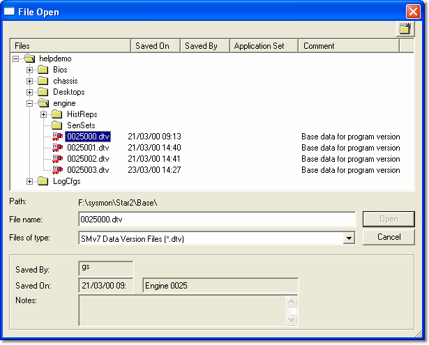

# Opening Files

To open files, select **File** > **Open** (Ctrl+O) to open the [File Type Selection](file-type-selection.md) dialog box.

If a Project is open, the following selections are available. Some types are only listed if the ECU supports them.

- **Data Version** - See [Using Data Version Files](../developing-data-versions/using-data-version-files.md).
- **Program Version** - See [Creating a Program Version](../program-and-data-versions/creating-a-program-version.md).
- **Desktop** - See [Desktop Files](../../using-system-monitor/desktop/desktop-files.md).
- **Live Logging Config** - See [Live Logging](../../data-acquisition/logging/live-logging/index.md).
- **Sensor Set** - See [Sensors & Actuators](../../data-acquisition/sensors/sensors-and-actuators/index.md).
- **Burst Logging Config** - See [Burst Logging](../../data-acquisition/logging/burst-logging/index.md).
- **Remote Logging Config** - See [Remote Logging](../../data-acquisition/logging/remote-logging/index.md).
- **External Inputs Config** - See [External Inputs Configuration](../../data-acquisition/sensors/external-inputs/external-inputs-configuration.md).
- **Pot Board Config** - The Pot Board configuration.
- **History Report** - See [History Report - Files](../../history-report/history-report-files.md).
- **Virtual Parameters** - See [Virtual Parameter Files](../../using-system-monitor/parameters/virtual-parameters/virtual-parameter-files.md).
- **CAN Config** - See [CAN Configuration](../../data-acquisition/logging/can-configuration/can-configuration-dialog-box/index.md).
- **Project** - See [Opening a Project](../projects/opening-a-project.md).

If no Project is open, the File Type Selection dialog box is not shown, because the only option available is to open a Project.

When you select the type of file, the File Open dialog box opens:

The **Files of type** filter is set to the selected file type, and the directory tree opens at the appropriate directory for that file type. You can browse for files of this type within your Multi-Application Base directory.

The Saved By, Saved On and Notes information (and, where applicable, the Consortium, Owner and RDA information) is displayed for the selected file.

If you are opening a **Program Version**, the check box is labelled **Same as current Program Version?**. If this is not selected, the current Project must be closed before the new Program Version can be opened.

For **Desktop** files only, the **Merge** button allows you to [merge](../../using-system-monitor/desktop/merging-desktops.md) the Desktop instead of loading it.

For **Data Version** files only, the **DataWizard** button allows you to open the file as a Candidate Data Version in the [Data Wizard](../data-wizard/data-wizard-candidate-version.md) instead of loading it.

**See also:** [Desktop Files](../../using-system-monitor/desktop/desktop-files.md); [Logging Configuration Files](../../data-acquisition/logging/logging-configuration-files.md); [Multi-Application Base](../customer-bases/multi-application-base.md)
