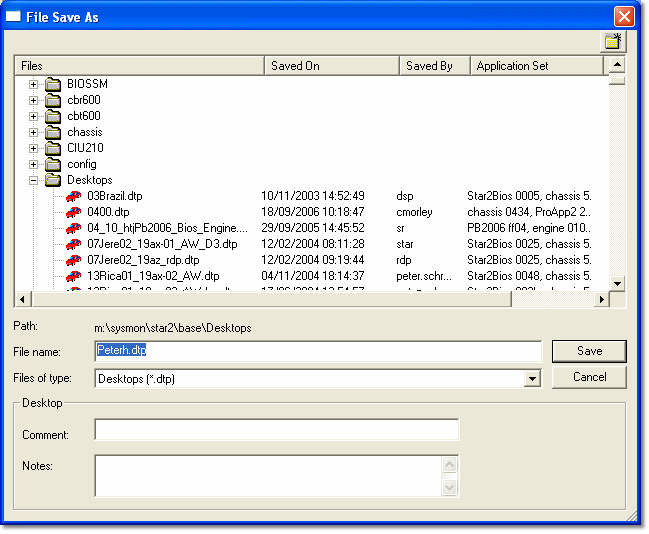
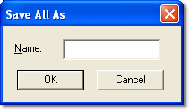

# Saving Files

The following Save commands are available on the **File** menu.

## Save

**File** > **Save** (Ctrl+S) saves a changed file under its original name.

The command opens a [File Type Selection](file-type-selection.md) dialog box that lists only the types of file that have been changed. The selected type of file is saved under its original name. There is no warning, and the original file is overwritten. If you want to keep an old version of a file, use Save As to save the new version under a different name.

If you select [Data Version](../developing-data-versions/index.md), you are prompted to choose a new name, unless the only change was to the Comment or Notes. The Advanced Setting **Auto-increment filename for all numerically terminated files on save (Y/N)** makes Save use the next available file name automatically.

## Save As

**File** > **Save As** (Alt+S) saves a file under a new name.

The command opens a File Type Selection dialog box that lists all the types of file that can be saved, whether they have changed or not. Select the type of file. The File Save As dialog box opens:

The **Files of type** filter is set to the selected file type, and the directory tree opens at the appropriate directory for that file type. You can browse for files of this type within your Multi-Application Base directory.

Enter a Comment and Notes as required. When you click **Save**, the file is saved and re-opened under its new name in System Monitor.

!!! note
    Data Versions may be locked by Team Security. To save a Data Version without security so that anyone can access it, select **Disabled** in the **Team Security** list of the File Save As dialog box. Where available, the **Disable RDA** check box saves the Data Version without RDA protection.

## Save Copy As

**File** > **Save Copy As** works like Save As, but the original file in System Monitor is not changed.

## Save All

**File** > **Save All** (Ctrl+Shift+S) saves all the files that have been changed under their original names. If you want to keep an old version of a file, use Save As to save the new version under a different name. Use Save or Save As if you only want to save a particular type of file.

If the [Data Version](../developing-data-versions/index.md) was changed, you are prompted to save it with an automatically generated new name, unless the only change was to the Comment or Notes.

## Save All As

**File** > **Save All As** saves a complete Project and all its files under a new name. The command opens the **Save All As** dialog box:

Enter a **Name** and click **OK**. A new project is created with the new name. All the [Project Files](types-of-files/project-files.md) are duplicated with the new name, in the same location as the original project.

**See also:** [Files](index.md); [File Type Selection](file-type-selection.md); [Closing a Project](../projects/closing-a-project.md)
