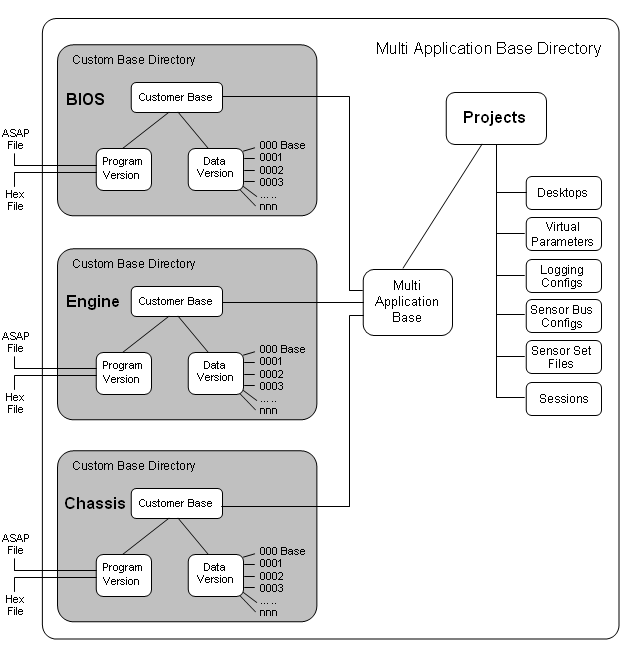

# Project Management

System Monitor has various safeguards to ensure that only the correct data and programs are transferred to an ECU. This is done either by using [Customer Bases](customer-bases/index.md), which link the [ASAP](asap-compatibility.md) project to the file directories used by System Monitor, or by using [Unit.Def Management](unit-def-management/introduction.md).

Each control system has associated ASAP and Hex files, which should be supplied by the ECU manufacturer. System Monitor generates [Program and Data Version files](program-and-data-versions/index.md) from these ASAP and Hex files and only accepts ASAP files from the ASAP project specified in the Customer Base. The Program and Data Version files are placed in the Customer Base directory.

A System Monitor Project links the Program and Data Version files for an ECU with the Desktop that you use to configure the ECU. When Customer Bases are used, each project is associated with a [Multi-Application Base](customer-bases/multi-application-base.md) that contains one or more [Applications](applications.md), and the Project files are placed in the Multi-Application Base Directory. When [Unit.Def](unit-def-management/file-management.md) support is used, the folder containing the project file is used as the base directory.

The Customer Bases and the Multi-Application Base are set up as part of your software package. If you have [Free User](customer-bases/free-user.md) status, you can create new Multi-Application Bases.

When any [Editable Parameters](../using-system-monitor/parameters/editable-parameters.md) are changed, the changes can be saved as a new Data Version file. The old Data Versions are kept so you can go back to them if you need to (see [Developing Data Versions](developing-data-versions/index.md)).

The System Monitor [Data Wizard](data-wizard/index.md) allows the current Data Version and previous Data Versions to be compared and, if required, merged.

The Project also contains other settings for the ECU such as [Logging](../data-acquisition/logging/index.md) and [Sensor](../data-acquisition/sensors/index.md) configurations.

**See also:** [Customer Base](customer-bases/index.md); [Unit.Def Management](unit-def-management/introduction.md); [Desktop](../using-system-monitor/desktop/index.md); [Applications](applications.md); [Program and Data Versions](program-and-data-versions/index.md); [Projects](projects/index.md); [Project Files](files/types-of-files/project-files.md); [Developing Data Versions](developing-data-versions/index.md)
