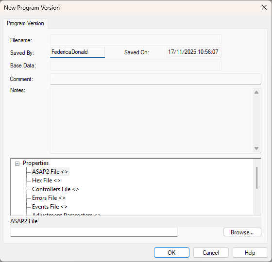

# Creating a Program Version

**Create Program and Data Version files:**

1. Make sure that your [ECU files](../files/types-of-files/ecu-files.md) are available.
2. Start System Monitor.
3. Select **File** > **New**. The File New dialog box opens.
4. Select **Program Version** from the **Document** list and click **OK**.

    If a Project is open, you are asked to confirm that it can be closed. If [Unit.Def](../unit-def-management/pgv-creation.md) configuration is enabled, a folder selection dialog box opens first so that you can select the base location for the new Program Version.

    The **New Program Version** dialog box opens.

    

5. Choose the files that you want to include in the Program Version. For each file, click its type in the **Properties** list and either enter the file name and path in the text box, or click **Browse** (or double-click the file type) to browse for the file. Choose files according to the following rules (see [ECU Files](../files/types-of-files/ecu-files.md) for more details):

    | File | Rule | Required? |
    |---|---|---|
    | **ASAP2 File** | Must come from the ASAP project specified in the [Customer Base](../customer-bases/index.md). | Required |
    | **Hex File** | Must match the ASAP2 file and be suitable for the ECU. | Required |
    | **Controllers File** | Must be suitable for the ECU. | Required |
    | **Errors File** | Required if you want to view [Errors](../../data-display/other-displays/errors/index.md). | Optional |
    | **Events File** | Required if you want to view [Events](../../data-display/other-displays/events/index.md). | Optional |
    | **Adjustment Parameters** | Required if you want to use an [Adjustment Board](../../hardware/adjustment-board.md). | Optional |
    | **Sensors File** | Required if a Sensor Injector file is loaded (see [Sensors](../../data-acquisition/sensors/index.md)). | Optional |
    | **Sensor Injector File** | Required if the Sensors file includes injectors (see [Sensors](../../data-acquisition/sensors/index.md)). | Optional |
    | **Sensor Enable/Disable File** | Required if you want to enable and disable sensors (see [Sensors](../../data-acquisition/sensors/index.md)). | Optional |
    | **Live AutoTune File** | Required if you want to use [Live Auto Tune](../../tuning/live-auto-tune.md). | Optional |

6. Enter a Comment and Notes, if required. When the ASAP2 file is selected, the Notes are filled in from the ASAP2 file.
7. Click **OK**.

The Program Version and Base Data Version files are generated and checked for consistency. If they are valid, they are saved. If the creation fails, an error is reported and the dialog box is shown again so that you can correct the file selection.

The file name and path of the Program Version are generated from the version string embedded in the ASAP file. The path is a new sub-directory, under the Customer Base directory, with the version string as its name. The file name is *version*.pgv. The ASAP file is linked to the Customer Base, or to the application in the [Unit.Def file](../unit-def-management/file-management.md), by the ASAP project name. With Unit.Def configuration, if no application folder is defined for the ASAP project, the Program Version is created under a folder with the ASAP project name in the selected base location.

The path of the Base Data Version is the same as for the Program Version. The default file name is *version*000.dtv.

The **Saved By** and **Saved On** boxes contain your user name and the time of day, both taken from the operating system. They cannot be edited.

**See also:** [Creating a Program Version - Command Line](creating-a-program-version-command-line.md); [Unit.Def PGV Creation](../unit-def-management/pgv-creation.md); [Unit.Def Files](../unit-def-management/file-management.md); [Creating a Project](../projects/creating-a-project/stage-1-define-project.md); [ECU Files](../files/types-of-files/ecu-files.md); [Getting Started](../../getting-started/index.md); [Program and Data Versions](index.md); [Project Files](../files/types-of-files/project-files.md)
