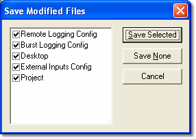

# Closing a Project

A Project can be closed without closing System Monitor, using **File** > **Close Project**. **File** > **Close Project & Select Base** closes the project and opens the Select Active Multi-Application Base dialog box.

The current Project is also closed automatically when you exit System Monitor, and when you open a Project, create a Project or create a Program Version.

When you close a project, System Monitor identifies any files that have been changed but not saved. If there are any such files, the Save Modified Files dialog box prompts you to save them.

The list shows the files that have been changed. All files are selected by default.

- Select or clear the checkboxes as required and click **Save Selected** to save the selected files and close the project.
- Click **Save None** to close the project without saving any files.
- Click **Cancel** to keep the project open.

**See also:** [Projects](index.md); [Saving Files](../files/saving-files.md)
