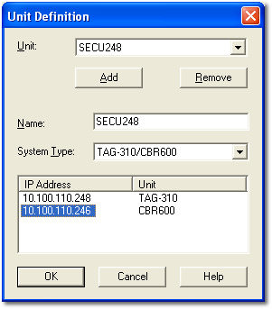

# Unit Definition

Some Electronic Control Units (ECUs) communicate with each other and with [ATLAS](../../../technical-support/atlas.md) over an Ethernet network. For this to work, each ECU which is (or may in the future be) connected to the network must have a unique IP address.

The Unit Definition links the ECU to a unit name. In systems that use more than one control unit (for example, one for Engine and one for Chassis), all the units are included in the Unit Definition.

The Unit Definitions are stored in a file whose location is defined by the Advanced Setting **File for unit ip addresses** (see [Advanced Settings](../../../using-system-monitor/settings.md)). The information may also be used by other applications such as ATLAS.

To open the Unit Definition dialog box, click **Edit Unit Definitions** or **Edit Spare Unit Definitions** on the [Connections tab](stage-2-connections.md) of the Project Properties dialog box.

**Add a new Unit Definition:**

1. Click **Add**. A new unit is added with a default name.
2. In **Name**, enter the name you want to use to identify the unit.
3. Select the type of ECU installed from the **System Type** drop-down list.
4. In the IP Address list, the Address column is set to Undefined. Overwrite Undefined with the IP address (this is supplied by your ECU supplier).

    Some System Types have multiple units with separate IP addresses. If this is the case, a row is shown for each unit.

5. Click **OK** to accept the new definition. The new name appears in the **Unit** list.

**Edit an existing Unit Definition:**

1. Select the Unit Definition that you want to edit from the **Unit** drop-down list.
2. Edit the **Name**, **System Type** and IP address, as required.
3. Click **OK** to accept the changes.

**Remove an existing Unit Definition:**

1. Select the Unit Definition that you want to remove from the **Unit** drop-down list.
2. Click **Remove**.
3. Confirm that you want to remove the Unit Definition.
4. Click **OK**.

**See also:** [Advanced Settings](../../../using-system-monitor/settings.md); [New Project - Connections](stage-2-connections.md); [Project Properties - Connections tab](../properties/connections.md); [Spare Unit](spare-car.md)
