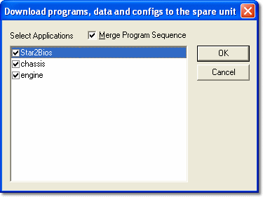
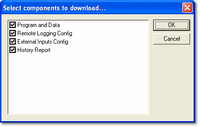

# Spare Unit

Typically, development and tuning is done using one unit, and it may be necessary to transfer the settings (Program and Data Versions) to another unit.

If the ECUs communicate over an Ethernet network, each unit has a unique IP address, so the unit(s) designated as the spare will have different address(es) from the unit(s) designated as main.

The Unit Definition for the spare unit is selected for the Project in the **Spare Unit** list on the [Connections tab](stage-2-connections.md) of the Project Properties dialog box.

## Program the Spare Unit

The Program Spare Unit command works in the same way as Reprogramming the ECU, except that the spare Unit Definition is used instead of the one for the main unit.

**Program the Spare Unit:**

1. Select **Tools** > **Program Spare Unit**. This command is only available if the project connects via **IP via Ethernet** and a spare unit has been defined.

    The Download programs, data and configs to the spare unit dialog box opens.

    

2. Select the applications to program. Use **Select All** or **Deselect All** if required.
3. Select the **Merge Program Sequence** check box if required.

    !!! note
        When programming selected applications into the ECU, you can choose to merge the programming sequences. When programming sensor sets which cover more than one application, the sequences are always merged.

4. Click **OK**. The Select components to download dialog box opens.

    

5. Select which components to download. The list can include **Program and Data**, **Sensors and Actuators**, **Remote Logging Config**, **Burst Logging Config**, **External Inputs Config** and **History Report**, depending on which files are loaded in the project.
6. Click **OK**.

System Monitor connects to the spare unit and downloads the selected components. When it has finished, the message "Finished downloading to the spare unit." is shown. If System Monitor cannot connect, the message "Failed to connect to the spare unit." is shown.

## Check Unit Status

To see which files are in the spare unit and to upload or download files, select **Tools** > **Unit Status** to open the [Unit Status](../../../ecu-control/unit-status.md) dialog box. **Tools** > **Sync Spare Unit to SM** is also available.

**See also:** [New Project - Connections](stage-2-connections.md); [Project Properties - Connections tab](../properties/connections.md); [Reprogramming the ECU](../../../ecu-control/ecu-memory/reprogramming-the-ecu.md)
