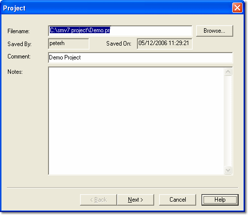

# Creating a Project

A project requires a Program Version for each Customer Base in the Multi-Application Base, so Program Versions must be created before you can create a Project. A project cannot be created if the active Multi-Application Base contains no Customer Bases.

The ECU manufacturer may supply Program Versions as well as the ECU files, in which case it is not necessary to create the Program Versions.

The New Project wizard has the following pages:

1. **Project** - described below.
2. **Desktop** - see [New Project - Desktop](stage-3-define-a-desktop.md).
3. **Program Version** - one page for each application; see [New Project - Program Version](stage-4-program-version.md).
4. **Virtual Parameters**, **CAN Config** and **Remote Logging Config** - optional files; see [New Project - Program Version](stage-4-program-version.md).

When you click **Finish**, the project is created and the Connections tab opens so that you can select the unit to communicate with (see [New Project - Connections](stage-2-connections.md)).

**Create a Project:**

1. Select **File** > **New**. The File New dialog box opens.
2. In the **Document** list, select **Project** and click **OK**. The New Project wizard opens at the Project page.

    If [Unit.Def](../../unit-def-management/project-management.md) configuration is enabled, a folder selection dialog box opens first so that you can select the location of the new project.

    

3. Enter a filename for the Project in the **Filename** text box. Alternatively, click **Browse** to browse for a path or for an existing project filename. You can only browse within the Multi-Application Base directory.
4. Enter a Comment and Notes, if required.
5. Click **Next** to continue to the Desktop page. See [New Project - Desktop](stage-3-define-a-desktop.md).

!!! note
    The **Saved By** and **Saved On** boxes contain your user name and the time of day, both taken from the operating system. They cannot be edited.

**See also:** [Projects](../index.md); [Creating a Program Version](../../program-and-data-versions/creating-a-program-version.md); [Project Files](../../files/types-of-files/project-files.md)
