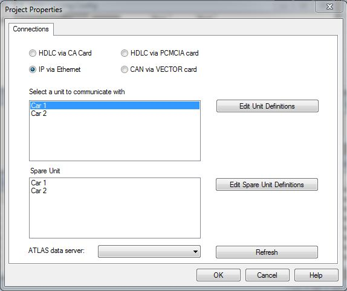

# New Project - Connections

When you click **Finish** in the New Project wizard, the project is created and the Project Properties dialog box opens at the **Connections** tab so that you can select how System Monitor connects to the ECU. The Connections tab is only shown automatically when the Advanced Setting **Prompt for unit connection on opening project (Y/N)** is set to Y (the default); otherwise, open it later with **File** > **Properties** > **Connections**.

System Monitor supports the following methods for connecting to an ECU:

| Option | Description |
|---|---|
| **HDLC via CA Card** | Connects to an ECU with a [CA Card](../../../hardware/communication-adaptor-ca-card.md). |
| **IP via Ethernet** | Connects to an ECU via Ethernet using TCP/IP. |
| **HDLC via PCMCIA card** | Connects to an ECU with a PCMCIA card. |
| **CAN via VECTOR card** | Connects to an ECU with a VECTOR card using the VECTOR XL Driver Library. |
| **PCAN-USB** | Connects to an ECU with a PCAN-USB adapter. |

!!! note
    The screenshot does not show the **PCAN-USB** option or the **Network Adapter** / **Baud Rate** list.

For the HDLC connections there is nothing else to configure. For **CAN via VECTOR card** and **PCAN-USB**, select the **Baud Rate**: 1 Mbit/s, 500 kbit/s, 250 kbit/s or 125 kbit/s. The unit and server options are only available for **IP via Ethernet**.

**Configure System Monitor to communicate via Ethernet:**

1. Select **IP via Ethernet**.
2. Select the **Network Adapter** to use, or **ANY**.
3. Select a Unit Definition from the **Select a unit to communicate with** list. This definition is used to program and tune the main unit.
4. Select a Unit Definition from the **Spare Unit** list. This definition is used to program the [Spare Unit](spare-car.md).
5. If you need to add, edit or remove a Unit Definition, click **Edit Unit Definitions** or **Edit Spare Unit Definitions** (see [Unit Definition](car-definition.md)).
6. Select a data server from the **ATLAS data server** drop-down list. Click **Refresh** to refresh the list if necessary.
7. Click **OK**.

!!! note
    The Connections configuration can be changed for an existing project on the [Project Properties - Connections tab](../properties/connections.md). You can also change the connection when [opening a project](../opening-a-project.md).

**See also:** [Creating a Project](stage-1-define-project.md); [Project Properties - Connections tab](../properties/connections.md); [Spare Unit](spare-car.md); [Unit Definition](car-definition.md)
