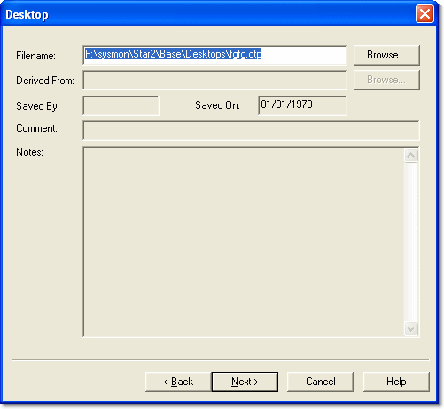

# New Project - Desktop

The Desktop page of the New Project wizard follows the Project page.

1. Enter a filename for the Desktop in the **Filename** text box.
2. Optionally, in the **Derived From** text box, enter the name of a Desktop file whose contents will be copied to your new Desktop.

    !!! note
        For either the **Filename** or the **Derived From** box, you can click **Browse** to browse for a path or for an existing Desktop file within the Multi-Application Base directory. The **Saved By** and **Saved On** boxes contain your user name and the time of day, both taken from the operating system. They cannot be edited.

3. Enter a Comment and Notes, if required.
4. Click **Next** to continue to the Program Version page. See [New Project - Program Version](stage-4-program-version.md).

**See also:** [Creating a Project](stage-1-define-project.md); [Desktop Files](../../../using-system-monitor/desktop/desktop-files.md)
