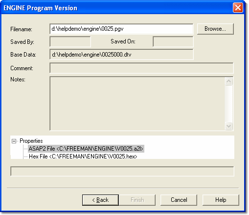

# New Project - Program Version

The Program Version pages of the New Project wizard follow the Desktop page.

A project requires a Program Version for each Customer Base in the Multi-Application Base, so a Program Version page is shown for each Customer Base. (With [Unit.Def](../../unit-def-management/file-management.md) configuration, a page is shown for each enabled application in the Unit.Def file.) The application name appears in the title of the page, in this example: ENGINE Program Version.

1. Enter or browse for the Program Version (.pgv) file that you want to use for this Customer Base within the project. You can only browse within the Customer Base directory.

    The remaining fields are read only:

    - **Saved By**, **Saved On**, **Comment** and **Notes** are taken from the selected Program Version file.
    - **Base Data** is the Data Version file generated when the Program Version was created.
    - The list of files used to create the Program Version can be viewed but not edited.

2. Click **Next**. Repeat for each Program Version page.

## Virtual Parameters, CAN Config and Remote Logging Config

The last three pages of the wizard let you add optional files to the new project. Leave the **Filename** empty if you do not want the file.

| Page | Description |
|---|---|
| **Virtual Parameters** | Enter or browse for a Virtual Parameters file. If the file does not exist, a new one is created. |
| **CAN Config** | Enter or browse for an existing CAN Config file. |
| **Remote Logging Config** | Enter or browse for a Remote Logging Config file. If the file does not exist, a new one is created. |

Click **Finish** on the last page to generate the Project. System Monitor creates the [project file structure](../../files/types-of-files/project-files.md), makes all applications active, creates the Desktop and opens the new project. The Connections tab then opens so that you can select the unit to communicate with (see [New Project - Connections](stage-2-connections.md)).

**See also:** [Creating a Program Version](../../program-and-data-versions/creating-a-program-version.md); [Creating a Project](stage-1-define-project.md); [Program and Data Version Files](../../files/types-of-files/program-and-data-version-files.md)
