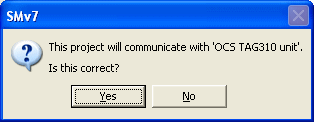

# Opening a Project

On start-up, System Monitor opens with no project loaded.

**Open a Project:**

Select **File** > **Open** (Ctrl+O). This opens a File Open dialog box with a filter set to Project (.prj) files. You can browse for files of this type within your Multi-Application Base Directory.

Alternatively, select a project from the recent projects list on the **File** menu, which shows the 10 most recently opened projects.

If no projects are available, follow the instructions in [Creating a Project](creating-a-project/stage-1-define-project.md).

When [Unit.Def](../unit-def-management/project-management.md) configuration is enabled, an additional **Open** submenu lets you open a project from any folder.

## Opening the most recent project automatically

The most recently opened project can be loaded automatically when System Monitor is started. To do this, select **Tools** > **Advanced Settings** and, in the Advanced Settings dialog box, set **Open most recently used project (Y/N)** to **Y**.

## Connection

As the project is opened, you are prompted to confirm the unit that the project will communicate with:

- Click **Yes** to open the project with this unit.
- Click **No** to open the Project Properties dialog box at the [Connections](properties/connections.md) tab, so that you can select a different Unit Definition.
- Click **Cancel** to open the project without connecting to a unit.

If the project does not specify a unit, a message tells you so and the Connections tab is opened.

This prompt is only shown when the Advanced Setting **Prompt for unit connection on opening project (Y/N)** is set to Y (the default).

**See also:** [Advanced Settings](../../using-system-monitor/settings.md); [Projects](index.md); [Creating a Project](creating-a-project/stage-1-define-project.md); [New Project - Connections](creating-a-project/stage-2-connections.md)
