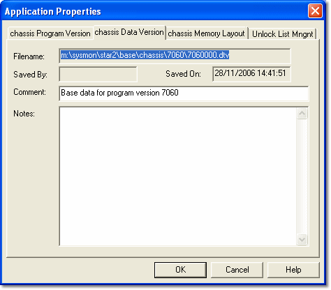

# Application Properties - Data Version tab

The Data Version tab displays the **Filename**, **Saved By** and **Saved On** information for the Data Version currently being used by the Application. These details are read only.

Edit the **Comment** and **Notes** as required.

!!! note
    To obtain similar information for the Data Version loaded into an ECU, use [ECU Search](../../../../ecu-control/ecu-search/index.md).

**See also:** [Application Properties](index.md); [Developing Data Versions](../../../developing-data-versions/index.md)
