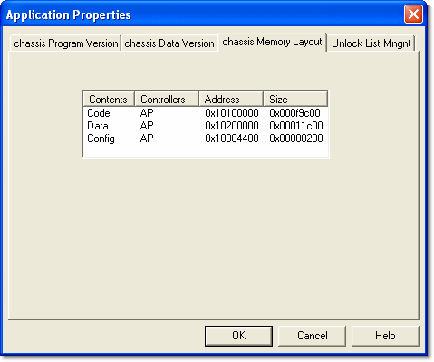

# Application Properties - Memory Layout

The Memory Layout tab displays the memory locations currently being used by the Application. The list has the columns **Contents**, **Controllers**, **Address** and **Size**.

The [ECU Properties - Controllers](../../../../ecu-control/ecu-properties/ecu-properties-controllers.md) tab allows you to view and enable or disable controllers.

For more information on memory contents, see [Read RAM](../../../../ecu-control/ecu-memory/read-ram.md).

**See also:** [Application Properties](index.md); [ECU Properties - Controllers](../../../../ecu-control/ecu-properties/ecu-properties-controllers.md)
