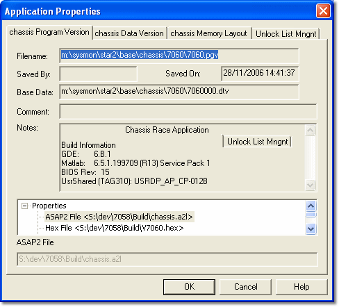

# Application Properties - Program Version

The Program Version tab displays the **Filename**, **Saved By**, **Saved On**, **Comment** and **Notes** information for the Program Version loaded into the Application.

The files used to create the Program Version are shown in the **Properties** list. The file name of the original Data Version, generated when the Program Version was created, is shown as **Base Data** (see [Developing Data Versions](../../../developing-data-versions/index.md)). This tab is read only.

!!! note
    To obtain similar information for the Program Version loaded into an ECU, use [ECU Search](../../../../ecu-control/ecu-search/index.md).

**See also:** [Application Properties](index.md); [Program and Data Versions](../../../program-and-data-versions/index.md)
