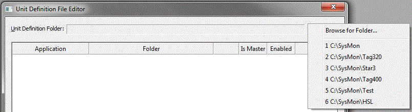
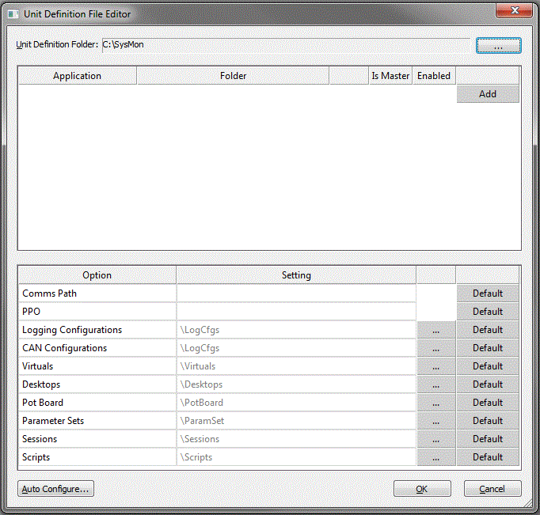
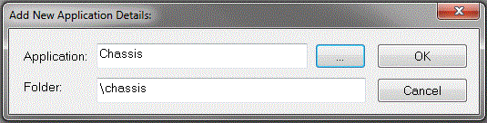
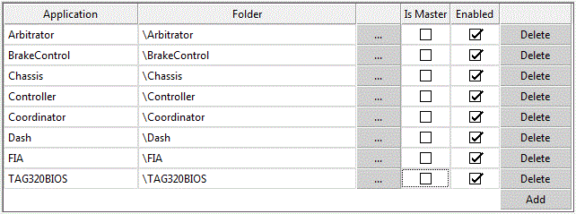
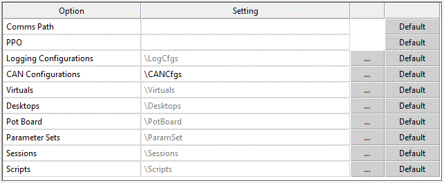
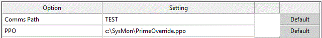

# Unit.Def Files

Unit.Def files are XML files, named **Unit.Def**, that contain definitions for project options. There can be one Unit.Def file per folder, and it is applied to projects opened in that folder.

Unit.Def files are only used when the Advanced Setting **Enable Unit.Def configuration (Y/N)** is set to Y (see [Introduction](introduction.md)).

Unit.Def files are configured with **File** > **Manage Unit.Def Files** (Ctrl+S), which is available when no project is open. This opens the Unit Definition File Editor, which lets you view, add or edit a Unit.Def file in any folder.

## Selecting a Unit.Def file to edit

Click the browse button (**...**) next to **Unit Definition Folder**. The first time, a folder selection dialog box opens so that you can select the location of the Unit.Def file. After that, the browse button offers a **Browse for Folder** option and a list of recently used Unit.Def folders.

Once a folder has been selected, the editor is populated either with the default settings or with the contents of the Unit.Def file in that folder.

## Configuring a Unit.Def file

A new Unit.Def file contains the option definitions, but the applications section is blank.

### Applications

Applications can be defined in two ways:

- Click **Add** to add an individual application definition. The Add New Application Details dialog box requires the **Application** (the ASAP definition name) and the default **Folder** in which to place all matching applications. These settings can be filled in automatically by selecting an existing PGV with the **...** button.

    

- Click **Auto Configure** to search the sub-folders and automatically configure any PGVs found, building up a table of application entries. You are asked to confirm, because this recalculates all application settings.

All paths are relative to the project file location.

The applications table has the columns **Application**, **Folder**, **Is Master** and **Enabled**:

- The default folder for an application can be changed with the associated folder selection button (**...**).
- An application can be temporarily excluded by clearing its **Enabled** option, or permanently removed with its **Delete** button.
- One application can be defined as the master application by selecting its **Is Master** option. This overrides the setting in the project for all applications.

### Options

The options table (columns **Option** and **Setting**) allows a number of non-default project settings to be defined. Default locations for project files can be defined with the folder selection button (**...**). Folder options that match the standard default are greyed out. All paths are relative to the project file location.

| Option | Default |
|---|---|
| **Comms Path** | (none) - overrides the comms path setting of all applications in the project. |
| **PPO** | (none) - the Prime Parameter Override file to use if prime parameters are being used. |
| **Logging Configurations** | \LogCfgs |
| **CAN Configurations** | \LogCfgs |
| **Virtuals** | \Virtuals |
| **Desktops** | \Desktops |
| **Pot Board** | \PotBoard |
| **Parameter Sets** | \ParamSet |
| **Sessions** | \Sessions |
| **Scripts** | \Scripts |

Each option can be reset with its **Default** button.

## Saving a Unit.Def file

When you select a different Unit.Def folder or click **OK**, you are asked whether to save any changes.

**See also:** [Introduction](introduction.md); [Unit.Def Project Management](project-management.md); [PGV Creation](pgv-creation.md); [Unit.Def Project Import](project-import.md)
