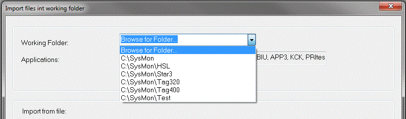

# Unit.Def Project Import

When Unit.Def configuration is enabled, the [Import](../files/importing-files.md) dialog box has a drop-down list for selecting the working folder for the import. The options are a **Browse for Folder** option and a list of recently used [Unit.Def](file-management.md) folders.

By default, the most recently used folder is selected.

**See also:** [Introduction](introduction.md); [Unit.Def Files](file-management.md); [Unit.Def Project Management](project-management.md); [PGV Creation](pgv-creation.md)
