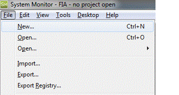

# Unit.Def Project Management

## Opening a project

When Unit.Def configuration is enabled, there are three ways to open a project, including a second **Open** option on the **File** menu.

1. **File** > **Open** (Ctrl+O) opens a file dialog box for projects located in the same folder as the most recently used [Unit.Def](file-management.md) file.
2. **File** > **Open** > (submenu) opens a project from any other folder. The submenu offers **Browse for Folder** and a list of recently used Unit.Def folders. This allows you to select a project in a different folder from the last used project, in the same way as selecting a different base with **Select Base** when Customer Bases are used.
3. The recent projects list allows quick selection of the 10 most recently opened projects.

## Unit.Def selection

When a project is selected for opening, System Monitor looks for a Unit.Def file in the same folder as the project.

## Creating a project

When you create a project with **File** > **New** > **Project**, a folder selection dialog box (**Select location for new project.**) opens first. If the Unit.Def file in the selected folder defines no applications, System Monitor configures the applications automatically from the PGVs found in the sub-folders. If Unit.Def files are found in sub-folders, the **Project Build Selection** dialog box asks you to select the project type you want to build.

**See also:** [Introduction](introduction.md); [Unit.Def Files](file-management.md); [PGV Creation](pgv-creation.md); [Unit.Def Project Import](project-import.md)
