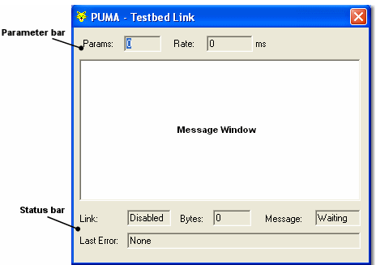

# Testbed Message

To open the Testbed Message window select **Tools** > **Testbed** > **Message Window**. Select the command again to close the window. The window title is **PUMA - Testbed Link**.

The window shows information about the communication between System Monitor and the testbed. It consists of the following areas.

## Parameters bar

PUMA defines a single block of parameters, and declares the rate at which it will request those parameters (see [Puma Commands - Data Acquisition](puma-commands/puma-commands-data-acquisition.md)).

The Parameters bar displays the following:

- **Params** - the number of parameters in the block
- **Rate** - the rate, in ms, at which PUMA has said it will request these parameters

## Message window

Shows the information which is being transferred between System Monitor and the testbed:

- **Commands** - the names of commands received from the testbed, for example "Select Parameters for Acquisition". Commands are shown as System Monitor or PUMA names, as set on the [Testbed Properties - Commands](testbed-properties/testbed-properties-commands.md) tab. See [Puma Commands](puma-commands/index.md).
- **Arguments** - shown indented below a command: for example, the identifiers of the parameters or map concerned, the file names sent with **Select Project and Embedded Data**, or **Online**/**Offline** for **Switch Offline/Online**.
- **Watchdog** - watchdog time-outs (see [Testbed Properties - Watchdog](testbed-properties/testbed-properties-watchdog.md)) are shown in the form:
    - *Byte timeout < bto seconds >*, where *bto* is the byte timeout value
    - *Message timeout < mto seconds >*, where *mto* is the message timeout value
- **Errors** - (see [Puma Errors](puma-commands/puma-errors.md)) possible values are:
    - *Command not executed*
    - *Error during execution <txt>*, where *txt* gives details of the error, for example "Invalid parameter" or "Not online"
    - *Command not available*

When debug is enabled (see [Testbed Properties - Debug](testbed-properties/testbed-properties-debug.md)), the text shown in the message window is also written to the debug file.

## Status bar

- **Link** - indicates the link status (see [Testbed Link](testbed-link.md)):
    - *Enabled* - link is enabled, but no bytes have been received
    - *Disabled* - link is not enabled
    - *Active* - link is enabled, and bytes have been received
    - *Inactive* - link is enabled, but a message timeout has occurred
- **Bytes** - the number of bytes received since (and including) the last **Init** command.
- **Message** - indicates the current message status:
    - *Waiting* - waiting for a command
    - *Received* - received a command, not yet sent a confirmation or definitive reply
    - *Confirmed* - sent a confirmation, not yet sent a definitive reply
    - *Replied* - sent a definitive reply
    - *Repeat* - waiting for PUMA to repeat a command after a byte timeout
- **Last Error** - shows the last error that occurred (or *None*). This is displayed even if the link has since recovered from the error. See [Puma Errors](puma-commands/puma-errors.md).
