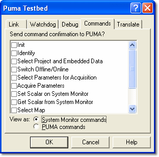

# Testbed Properties – Commands

Use the **Commands** tab to configure the way System Monitor responds to PUMA commands.

| Control | Description |
|---|---|
| **Send command confirmation to PUMA?** | When PUMA sends System Monitor a command, it expects a reply within a certain time. If System Monitor is not able to execute the command and reply within that time, a command confirmation message may be sent in place of the reply. This gives System Monitor longer to execute the command and allows the definitive reply to be sent later.  The list shows each supported command. When a command's check box is selected, that command is confirmed before the definitive reply is sent. |
| **View as** | PUMA uses different command names to System Monitor. Select **System Monitor commands** or **PUMA commands** to choose how commands are named in this list and in the [Testbed Message](../testbed-message.md) window. |

**See also:** [Puma Commands](../puma-commands/index.md); [Puma Command List](../puma-commands/puma-command-list.md)
