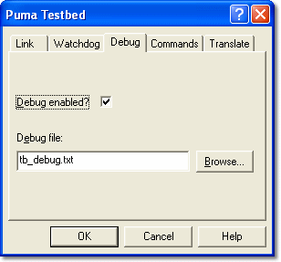

# Testbed Properties – Debug

Use the **Debug** tab to configure the Debug file.

| Control | Description |
|---|---|
| **Debug enabled?** | When checked, the text that appears in the [Testbed Message](../testbed-message.md) window is copied to the Debug file while the link is enabled. If the file already exists, text is appended to it. |
| **Debug file** | Enter, or click **Browse...** to select, the name and path of the file where you want to save the debug information. The default name is **tb_debug.txt**. A file name must be entered if debug is enabled. |

The debug file is opened when the Testbed Link is enabled and closed when it is disabled. The Debug settings cannot be changed while the Testbed Link is enabled.

**See also:** [Testbed Link](../testbed-link.md)
