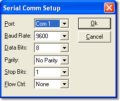

# Testbed Properties – Link

Configure the link between PUMA and System Monitor on the **Link** tab.

The tab has the following controls:

| Control | Description |
|---|---|
| **Mode** | Sets the way that the link operates. Select one of:  **Measurement** - PUMA can take measurements from System Monitor. System Monitor only responds to the Initialisation commands, **Select Project and Embedded Data** and the Data Acquisition commands; all other commands receive a *command not available* reply.  **Full-operation** - System Monitor responds to all the [supported commands](../puma-commands/puma-command-list.md) sent by PUMA. [Live Tune](../../tuning/live-tune.md) must be available, as it is switched on when the link is enabled. |
| **RS-232** / **TCP/IP** | Selects the type of connection to the testbed. The default is RS-232. |
| **Setup...** | Opens the **Serial Comm Setup** dialog box (RS-232) or the **IP Comms Setup** dialog box (TCP/IP). |

## Serial Comm Setup

Sets the **Port**, **Baud Rate**, **Data Bits**, **Parity**, **Stop Bits** and **Flow Ctrl** for the serial link. The default settings are chosen to suit most applications.

## IP Comms Setup

Sets the **Port** on which System Monitor listens for a TCP/IP connection from PUMA. System Monitor acts as the server. The default port is 2000.

If the setup is not working, check that it conforms to the requirements of your testbed. The testbed settings are saved in the `Testbed.cfg` file in the System Monitor configuration files folder, not in the Project.
