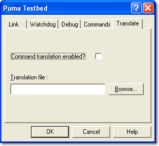

# Testbed Properties – Translate

Use the **Translate** tab to configure the correspondence between PUMA and System Monitor parameter identifiers.

| Control | Description |
|---|---|
| **Command translation enabled?** | When selected, the parameter and map [identifiers](../../using-system-monitor/parameters/names-descriptions-and-groups.md) sent by PUMA are translated to those used by System Monitor, using the translation file. Every identifier PUMA sends must then be in the translation file; otherwise the command fails with the error "Could not translate identifier". |
| **Translation file** | Enter, or click **Browse...** to select, the name and path of the translation file (**\*.ini**). The file must exist if translation is enabled. |

Each line of the translation file contains a PUMA identifier followed by the equivalent System Monitor identifier, each enclosed in double quotes. Text outside the quotes is ignored.

The translation file is loaded when the Testbed Link is enabled. If it cannot be loaded, System Monitor warns that this will cause execution errors in commands that require translation.
