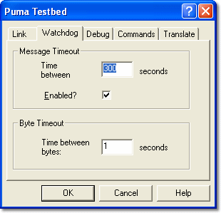

# Testbed Properties – Watchdog

Configure the watchdogs on the link between PUMA and System Monitor on the **Watchdog** tab.

## Message Timeout

**Time between messages** - Enter the timeout period in seconds. The range is 0.1 to 36000 seconds. The default is 300 seconds.

**Enabled?** - When checked, the link is reset if the time between messages exceeds the value in **Time between messages**. The message timeout is shown in the [Testbed Message](../testbed-message.md) window and the link status becomes *Inactive*. PUMA must then send **Init** and **Identify** again to re-establish the link. Enabled by default.

## Byte Timeout

**Time between bytes** - System Monitor sends a request to the PUMA testbed to repeat the last command if the time between bytes of the same message is greater than this value. The range is 0.1 to 100 seconds. The default is 1 second. This feature is always enabled.

!!! note
    The Watchdog properties cannot be changed while the Testbed Link is enabled, because **Tools** > **Testbed** > **Configure** is not available.

**See also:** [Testbed Link](../testbed-link.md)
