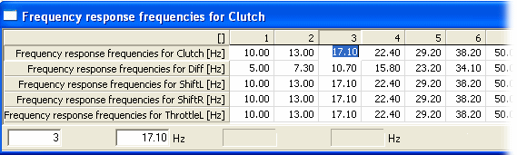
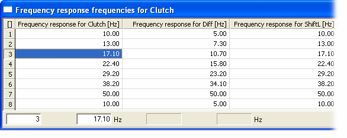

# 1 axis Map – Multiple Parameters

A 1-Axis Map Edit window can contain any number of 1-Axis Map parameters, as long as they all use a common axis. If a selected parameter does not share the axis, a warning is shown and the parameter is not included in the window.

Each parameter has a row in the table.

1-Axis Map with multiple parameters – normal orientation

Select **Orientation** in the Window System Menu to rotate the view so that the parameter values are arranged in columns.

1-Axis Map with multiple parameters – rotated

**See also:** [1 axis Map](1-axis-map.md); [Graphical View – 1 axis](../graphical-maps/graphical-view-1-axis.md)
