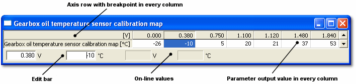

# 1 axis Map

A 1-Axis Map is a one-dimensional lookup table in which the output value depends on which point on the axis is currently selected. The point on the axis (the Breakpoint) may be selected internally by the ECU program or by the Index Parameter, which is a Measurement Parameter. A Breakpoint is selected when the value of the Index Parameter exceeds the Breakpoint value.

The axis and the Index Parameter are defined in the ASAP file and cannot be edited in System Monitor. The parameter values and the Breakpoint values can be edited.

To open a 1-Axis Map window, select **Desktop** > **Window** > **1-Axis Map** (Alt+Shift+1). A window can contain several 1-Axis Map parameters that share an axis; see [1 axis Map – Multiple Parameters](1-axis-map-multiple-parameters.md).

1-Axis Map with one parameter

## Features

- When an ECU is connected and On-Line, the cell selected by the Breakpoint (the active cell) is outlined in black. See also [Cursor Control and Trace](../../ecu-control/cursor-control-and-trace.md).
- When a value is changed and accepted, its colour changes to the Greater than / Less than colour (default red/blue) as appropriate. These colours are set in the Display tab of the Window Properties dialog box.
- A [String](../string-window.md) parameter can be associated with a 1-Axis Map. The value of the string is shown in the String Bar, below the output values, when **Show String Bar** is selected in the Window System Menu.
- The Edit Bar has edit boxes for the Breakpoint value and the output value of the selected cell. The non-editable boxes show the value of the Index Parameter and the associated output value when the ECU is On-Line. The Edit Bar is shown when **Show Edit Bar** is selected in the Window System Menu.
- The Window System Menu selects how the values are shown:
    - **Engineering**, **Raw Hexadecimal** or **Raw Decimal** values, or the **Address** of each value.
    - **Live Tune Overview** - the values are not shown and the empty cells are made as small as possible so that more of the map is in view.
    - **Graphical** and **Difference** views. See [Graphical Maps](../graphical-maps/index.md). **Toggle Grid / Graphical** (Alt+G) switches between the last grid view and the last graphical view.
- **Orientation** in the Window System Menu rotates the table. Other options include **AutoZoom**, **Show Trace as Block** and **Export 2d Map...**.
- Controls for the appearance of the window are on the Display tab of the Window Properties dialog box.

**See also:** [Axis Properties](../../using-system-monitor/parameters/parameter-properties/axis-properties/index.md); [Creating Windows](../../using-system-monitor/windows/creating-windows/index.md); [Graphical View – 1 axis](../graphical-maps/graphical-view-1-axis.md); [Parameter Properties – 1-Axis Map tab](../../using-system-monitor/parameters/parameter-properties/1-axis-map-tab.md)
