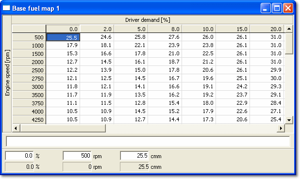

# 2 axis Map

A 2-Axis Map is a two-dimensional lookup table in which the output value depends on which points on the axes are currently selected. The points on the axes (the Breakpoints) may be selected internally by the ECU program or by Index Parameters, which are Measurement Parameters. A Breakpoint is selected when the value of the Index Parameter exceeds the Breakpoint value.

A 2-Axis Map Edit window can contain only one 2-Axis Map parameter. To open one, select **Desktop** > **Window** > **2-Axis Map** (Alt+Shift+2). The axes and the Index Parameters are defined in the ASAP file and cannot be edited in System Monitor.

## Features

- The output values and the Breakpoint values can be edited. When a value is changed and accepted, its colour changes to the Greater than / Less than colour (default red/blue) as appropriate. These colours are set in the Display tab of the Window Properties dialog box.
- When an ECU is connected and On-Line, the cell selected by the Breakpoints (the active cell) is outlined in black. See also [Cursor Control and Trace](../ecu-control/cursor-control-and-trace.md).
- The window is a grid of cells with the following rows, from top to bottom:
    - The X-axis identifier name.
    - An X-axis row, with a Breakpoint value in each column.
    - A row for each Y-axis Breakpoint, with an output value in each column. The first column contains the Y-axis identifier name and the second column contains the Y-axis Breakpoints.
- A [String](string-window.md) parameter can be associated with a 2-Axis Map. The value of the string is shown in the String Bar, below the output values, when **Show String Bar** is selected in the Window System Menu.
- The Edit Bar has edit boxes for the X-axis Breakpoint value, the Y-axis Breakpoint value and the value of the selected cell. The non-editable boxes below them show the values of the Index Parameters and the associated output value when the ECU is On-Line. The Edit Bar is shown at the bottom of the window when **Show Edit Bar** is selected in the Window System Menu.
- The window title and the titles of the X and Y axes can show the Name, the Description or both. This is set in the Parameters tab of the Window Properties dialog box.
- The Window System Menu selects how the values are shown:
    - **Engineering**, **Raw Hexadecimal** or **Raw Decimal** values, or the **Address** of each value.
    - **Live Tune Overview** - the values are not shown and the empty cells are made as small as possible so that more of the map is in view.
    - **Graphical**, **Difference** and **End** views. See [Graphical Maps](graphical-maps/index.md). **Toggle Grid / Graphical** (Alt+G) switches between the last grid view and the last graphical view.
- **Orientation** in the Window System Menu exchanges the X and Y axes.
- Other Window System Menu options include **AutoZoom**, **Centre Active Site**, **Show Trace as Block** and **Export 3d Map...**.
- Controls for the appearance of the window are on the Display tab of the Window Properties dialog box.

**See also:** [Changing Parameter Values](changing-parameter-values/index.md); [Editable Parameters](../using-system-monitor/parameters/editable-parameters.md); [Graphical View – 2 axis](graphical-maps/graphical-view-2-axis.md); [Measurement Parameters](../using-system-monitor/parameters/measurement-parameters.md); [Parameter Properties – 2-Axis Map tab](../using-system-monitor/parameters/parameter-properties/2-axis-map-tab.md)
