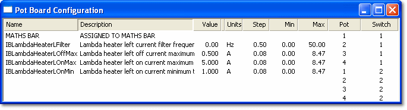

# Adjustment (Pot) Board Configuration

The Pot Board Configuration window assigns parameters to the controls of the [Adjustment Board](../../hardware/adjustment-board.md). The assignments are stored in a Pot Board Config file (`.pbc`, default folder `PotBoard`), which must be open in the project. Create one with **File** > **New**, or open an existing one; recently used files are listed under **Tools** > **Pot Board** > **Recent Files**.

To open the Pot Board Configuration window, select **Tools** > **Pot Board** > **Configure...** or **Desktop** > **Window** > **Pot Board** (Ctrl+Shift+F1).

The window has eight rows, one for each combination of the four controls (**Pot** 1 to 4) and the two switch positions (**Switch** 1 and 2). The Pot numbers correspond to the labels on the controls of the board. Rows with no parameter assigned are blank.

| Column | Description |
|---|---|
| **Name** / **Description** | The assigned parameter. |
| **Value** / **Units** | The current value of the parameter. |
| **Step** | The change in value for each click of the control. Editable. |
| **Min** / **Max** | The range within which the control adjusts the value. Editable, but cannot be set outside the parameter's own limits. |
| **Pot** / **Switch** | The control and switch position for the row. |

## Assign a parameter to a control

1. Locate the parameter in the Parameter Explorer.
2. Drag it on to the row for the required control (or copy it and paste it into the row).

Only Scalar parameters that can be live tuned can be assigned, one per row.

## Clear an assignment

1. Right-click the row and select **Remove** from the context menu.

## Assign a control to the Maths Bar

The [Maths Bar](../../using-system-monitor/tool-and-information-bars/maths-bar.md) can be assigned to any control. Right-click the row and select **Maths Bar** from the context menu. Turning that control then operates the Maths Bar **+** and **-** buttons on the values selected in the active window.

The context menu also has **Undo**, **Copy**, **Paste**, **Select All**, **Restore Value** and **Properties...**.

The connection to the board is set in the [Pot Board Properties](pot-board-properties.md).

**See also:** [Adjustment Board](../../hardware/adjustment-board.md); [Adjustment Board Control](adjustment-board-control.md)
