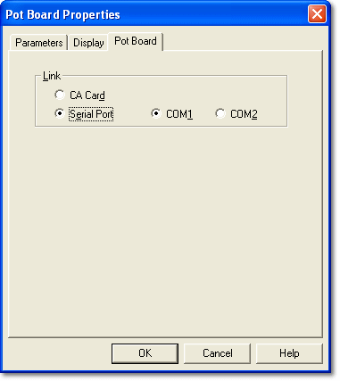

# Pot Board Properties

The **Pot Board** tab of the Pot Board Properties dialog box sets the connection between System Monitor and the Adjustment Board. To open the dialog box, select **Window Properties...** from the Window System Menu of the [Pot Board Configuration](adjustment-board-configuration.md) window (Alt+Enter).

The **Link** panel has two options:

- **CA Card** - Select this if the Adjustment Board is connected through the [CA-Card](../../hardware/communication-adaptor-ca-card.md).
- **Serial Port** - Select this if the Adjustment Board is connected to a serial port on the PC, then select the port from the list. The list shows the COM ports (COM1 to COM20) that exist on the PC. The port is configured to suit the Adjustment Board, irrespective of the Windows settings.

The link setting is saved in the Pot Board Config file.

**See also:** [Adjustment Board](../../hardware/adjustment-board.md); [Adjustment Board Control](adjustment-board-control.md)
